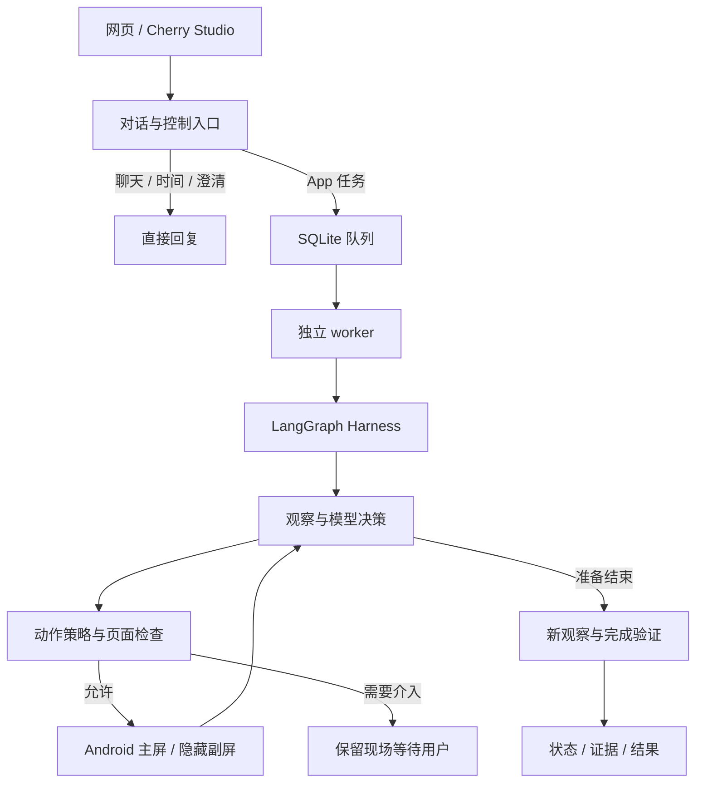

# Sidecar（伴行）

通过自然语言操作 Android App 界面的 Agent。用户从网页或 Cherry Studio 提交任务，Sidecar 在执行设备上观察页面、决定动作、填写内容并核对结果；需要本人处理时保留现场，等待用户介入。

当前实现是 **Python 服务 + Android 设备适配器 + 实验性隐藏副屏**。已支持 Mac 上的 Android 模拟器；不是在 iPhone 后台操作 App。iPhone 可以作为网页入口，实际执行仍发生在 Android，跨端结果是否同步取决于目标 App 和账号。

## 当前能力与边界

| 能力 | 当前实现 |
| --- | --- |
| 对话入口 | Android 模式下区分普通对话、澄清、时间查询和 App 任务；网页与 OpenAI 兼容接口共用对话服务 |
| GUI 执行 | 读取控件树和截图，执行点击、文字替换、滑动、返回和等待；每步核对页面变化 |
| 多 App | 配置允许列表及名称别名，一项任务只操作一个目标 App |
| 任务管理 | SQLite 持久队列、检查点、事件与动作日志；暂停、取消、人工交接和中断恢复 |
| 隐藏副屏 | Android 15+；观察与输入绑定同一副屏，失联时不回退主屏 |
| 执行画面 | 网页实时帧与最近观察、每轮执行录像；可另开 scrcpy 只读预览窗口 |
| 结果验证 | 新观察上的逐项模型核验；Google 时钟与 Gmail 草稿另有程序验证器 |
| 离线演示 | 无需设备和密钥的模拟待办，用于检查执行流程，不会操作真实 App |

**发送、发布、支付、转账、账号安全变更和破坏性操作不会由 Agent 自动完成。** 发送类任务只准备内容并交给用户核对；“继续”不授权自动发送。密码、登录、验证码等敏感页面需要本人接管。

允许列表表示可尝试操作，不表示该 App 已完整验收。隐藏副屏仍共享 Android 账号、应用数据、音频和部分系统能力，不是独立的 App 分身或虚拟机。

## 安装与配置

需要 Python 3.11+、macOS 或 Linux。执行锁使用 Unix 文件锁，当前不支持原生 Windows。以下命令从仓库根目录运行。

```bash
python3 -m venv .venv
source .venv/bin/activate
python -m pip install -e '.[dev,android]'
```

如需复用仓库中的依赖版本快照：

```bash
python -m pip install -c requirements-lock.txt -e '.[dev,android]'
```

`requirements-lock.txt` 不包含安装包哈希。只运行离线演示时，可安装 `.[dev]`，不需要 Android 依赖。

### 模型与配对码

复制 [.env.example](.env.example)，填写模型名称、服务地址和密钥。CLI **不会自动加载 `.env`**，启动服务前显式加载：

```bash
cp .env.example .env
# 编辑 .env 后执行；不要提交真实密钥
set -a
source .env
set +a
```

| 变量 | 作用 |
| --- | --- |
| `SIDECAR_MODEL` | 模型名称；Android 模式必填 |
| `SIDECAR_API_KEY` | 模型服务密钥；Android 模式必填 |
| `SIDECAR_BASE_URL` | OpenAI 兼容地址；省略时使用 ChatOpenAI 默认端点 |
| `SIDECAR_PAIRING_TOKEN` | 可选，固定网页和 Cherry Studio 使用的配对码；与模型密钥不同 |
| `SIDECAR_TIMEZONE` | 对话报时的 IANA 时区，默认 `Asia/Shanghai` |

未设置固定配对码时，服务生成并保存 `<运行目录>/pairing-token`，同一目录重启会复用。`.env.example` 中的 Dify 配置是预留项，当前没有对应的知识库/MCP 接入。

官方 DeepSeek 端点使用 JSON 模式及本地结构校验，其他端点使用 JSON Schema。是否发送图像由 `model.py` 中的模型适配规则决定；文本模式只使用可见文本和元素 ID。模型名称与图片能力仍需和实际提供商核对，详见 [DeepSeek 配置说明](docs/deepseek.md)。

任务、允许页面的观察和近期动作摘要会发送给配置的模型服务；图像模式还会发送截图。Harness 禁用继承的全局 LangSmith 追踪。

## 快速启动

### 1. 离线演示

```bash
sidecar --home .sidecar/demo demo --item '复习项目架构' --item '检查提交材料'
```

返回任务编号、状态和验证结果，标记为 `offline_demo`。这只是本地模拟待办，不会设置真实闹钟或发送邮件。

也可启动离线网页服务：

```bash
sidecar --home .sidecar/demo-console serve
```

打开 `http://127.0.0.1:8765` 并输入终端打印的配对码。离线模式下，OpenAI 兼容接口将普通任务消息记录为模拟待办。

如需在模拟设备上测试真实模型决策：

```bash
sidecar --home .sidecar/model-demo demo --llm \
  --goal '把整理演示视频加入待办，保存后检查结果' --item '整理演示视频'
```

`--llm` 只用于 `demo`；Android 服务本身就会调用配置的模型。

### 2. Android 隐藏副屏

先启动 Android 15+ 模拟器，安装并登录目标 App，确认设备在线。隐藏副屏需要 `adb`、`scrcpy` 和 `ffmpeg` 在 PATH 中；已有联调使用 scrcpy 5.0.1。

```bash
# macOS；Android SDK/模拟器需另行准备
brew install scrcpy ffmpeg
# Homebrew Android command-line tools 的常见路径；按实际安装位置调整
export PATH="/opt/homebrew/share/android-commandlinetools/platform-tools:$PATH"
adb devices -l

sidecar --home ~/.sidecar/android-clock serve --android --hidden-display \
  --serial emulator-5554 --port 8766 \
  --package com.google.android.deskclock \
  --allowed-packages com.google.android.deskclock,com.google.android.gm \
  --app-alias com.google.android.gm=Gmail \
  --app-alias com.google.android.gm=谷歌邮箱
```

打开 `http://127.0.0.1:8766`，输入本次服务的配对码。`serve` 自动启动独立 worker；关闭网页或断开聊天不会取消后台任务，宿主机与 Android 设备需要保持运行。

去掉 `--hidden-display` 会直接操作 Android 主屏；去掉 `--android` 则是离线演示。默认只监听 `127.0.0.1`。若从手机访问，需自行配置可达的监听地址和网络；当前服务没有内置 HTTPS 或后台推送。

`--home` 必须放在子命令前，后续查询、取消、导出、重启 worker 均使用同一个运行目录。

### 3. 接入 Cherry Studio

添加使用 **OpenAI Chat Completions** 的自定义提供商：

| 配置项 | Android 示例 |
| --- | --- |
| Base URL | `http://127.0.0.1:8766/v1` |
| API Key | Sidecar 打印的配对码，或 `SIDECAR_PAIRING_TOKEN` |
| 模型 | `sidecar-agent` |
| 流式输出 | 支持 |

Sidecar 实现 `/v1/models` 和 `/v1/chat/completions`，没有实现 `/v1/responses`。请求地址为 Responses 时会返回 404。

Android 模式下，可以直接聊天、询问时间或提交明确的 App 任务。例如：

- `现在几点了？`：读取服务端时钟，不创建设备任务。
- `在时钟里创建并开启 23:58 的闹钟`：创建 Android 执行任务。
- `在 Gmail 保存一封草稿，收件人 demo@example.com，主题为“测试”，正文为“早上好”`：尝试保存并核对草稿，不发送。

普通对话仍依赖模型配置和网络；没有网页搜索或天气工具。对话服务失败时不会自动变成手机任务。后续修改会参考对话中的任务编号；原任务未结束或指代不明确时先澄清。

流式回复展示任务编号、状态变化、心跳和结果，不是内部推理。流式和非流式请求最多等待 120 秒；等待结束不代表任务停止，可按编号查询。用量块当前为 0，不代表真实模型调用免费。

同一次请求重试会复用任务，去重记录跨服务重启保留。主动再执行相同目标时请发送新的对话轮次；API 调用可提供新的 `Idempotency-Key`。同一 key 不能用于不同请求。

## App 选择与执行隔离

`--package` 是默认目标；只提供它时，也作为唯一允许的 App。显式配置 `--allowed-packages` 后，默认目标必须包含在列表中。名称别名可重复指定：

```bash
--allowed-packages com.tencent.weread,notion.id \
--package com.tencent.weread \
--app-alias notion.id=Notion \
--app-alias com.tencent.weread=微信读书
```

任务表单/API 可用 `app` 指定允许列表内的包名。聊天入口先整理完整目标，再按应用名称、别名或包名确定目标；多 App 场景请明确写出应用名称。歧义、越界或一个目标涉及多个 App 时需澄清或拆分。安装新 App 不会自动授予操作权限。

副屏编号、唯一标识及 Android 启动标识共同确定执行环境。目标 App 正在主屏使用时拒绝启动副屏任务；若主屏保留该 App 的后台任务，当前启动逻辑会先强制停止该包，再在副屏启动。**执行期间不要在主屏打开同一个 App**，Android 可能将其现有任务移回主屏，造成副屏前台读取失败。

副屏输入使用附带的 Android 桥接程序，对明确的可编辑节点执行 `ACTION_SET_TEXT`，替换文字并验证；不使用剪贴板或全局键盘输入。自定义输入框仍需逐 App 验证。详见 [Android 输入桥接说明](android/textbridge/README.md)。

worker 在执行结束为完成、失败或取消时尝试清理目标 App 的副屏窗口；仅移除核对归属后的副屏任务，不使用全局强制停止。暂停、等待介入或中断会保留现场。清理窗口不等于撤销写入或删除 App 数据。

## 查看副屏、录像与重启

### 网页执行画面

选择任务，点击“查看执行画面”。控制台区分实时帧、视频停滞和最近观察；每轮执行/恢复结束后可下载该轮录像。实时画面和录像只帮助查看过程，不独立证明任务成功。

录像在 `<运行目录>/recordings/<任务编号>/<会话编号>/` 下，包含 `recording.mkv`、`latest.png` 和 `stream.json`。录像可能不完整，以元信息和下载文件名为准。当前网页没有鼠标接管副屏的面板。

### 打开或重开桌面预览

服务默认隐藏副屏镜像窗口。要看实时操作，可另开一个只读 scrcpy 窗口。以下命令从当前运行目录读取绑定编号，不要复制历史记录里的固定编号：

```bash
SIDECAR_RUN_HOME="$HOME/.sidecar/android-clock"
SIDECAR_DISPLAY_ID=$(python - "$SIDECAR_RUN_HOME" <<'PY'
import json
import sqlite3
import sys
from pathlib import Path

uri = (Path(sys.argv[1]).resolve() / "queue.sqlite").as_uri() + "?mode=ro"
with sqlite3.connect(uri, uri=True) as db:
    config = json.loads(db.execute("SELECT body FROM settings WHERE id=1").fetchone()[0])
print(config["display"]["id"])
PY
)
scrcpy --serial emulator-5554 --display-id="$SIDECAR_DISPLAY_ID" \
  --no-audio --no-control --no-clipboard-autosync \
  --window-title='Sidecar Agent · 副屏实时预览' \
  --window-width=400 --window-height=800 --max-fps=15 --always-on-top
```

在已启动隐藏副屏服务的前提下运行，设备编号应与服务一致。关闭此预览窗口再运行命令即可重开，不会销毁 Agent 的执行副屏。副屏上没有应用时可能黑屏；预览窗口为只读，点击它不会操作 Android。

### 更新代码或重启执行进程

| 操作 | 是否需要重启 |
| --- | --- |
| 打开、关闭或重开 scrcpy 预览 | 不需要重启 Sidecar |
| 修改 Agent 执行逻辑或模型环境变量 | 需要重新启动 worker；旧进程不会自动加载修改 |
| 修改网页服务或对话入口逻辑 | 需要重新启动服务；相关 worker 修改也需重启 worker |
| 重建隐藏副屏 | 需要结束未完成任务，再停止并重启隐藏副屏服务 |

服务和 worker 是独立进程，**仅重启服务不保证旧 worker 被替换**。先查询并处理未完成任务，再用进程列表确认对应 `--home` 的 worker PID，停止旧 worker 后，从已经加载环境变量的终端运行：

```bash
sidecar --home ~/.sidecar/android-clock worker
```

该命令在当前终端持续运行；不要在旧 worker 仍持有锁时重复启动来代替重启。只重启 worker 可以保留原服务、副屏及预览连接。

完整重启时，先结束未完成任务、停止对应 worker，再停止原 `serve` 进程，重新执行原启动命令。新副屏会有新的身份，预览也需重新连接。旧副屏上的暂停任务不能直接恢复到新副屏，应核对已有结果后提交新任务。

## 队列与人工交接

同一队列一次只执行一项任务。`waiting_user`、`paused` 和 `interrupted` 会占用执行位置，后面的 `queued` 任务不会自动越过它们。

| 状态 | 含义与下一步 |
| --- | --- |
| `queued` | 等待执行；查看回复中的阻塞任务编号 |
| `executing` / `running` | 队列已领取 / 引擎正在运行 |
| `waiting_user` | 需要处理页面、核对结果或最终提交；也可能是验证证据不足 |
| `paused` | 已暂停，核对后可继续 |
| `interrupted` | 执行中断，核对现场后可继续或取消 |
| `completed` / `failed` / `cancelled` | 已结束，不能恢复；需再次执行时提交新任务 |

在 Cherry Studio **单独发送**控制指令，编号使用完整的 32 位任务 ID：

| 指令 | 作用 |
| --- | --- |
| `查询 <编号>` / `状态 <编号>` / `进度 <编号>` | 只读查询，不启动任务 |
| `暂停 <编号>` | 在步骤边界暂停 |
| `继续 <编号>` / `恢复 <编号>` | 核对现场后恢复，从新观察开始 |
| `取消 <编号>` / `停止 <编号>` | 放弃任务，已生效的操作不会撤销 |
| `任务列表` / `查看队列` | 最近 50 条任务及阻塞情况 |
| `清空队列` / `清除任务队列` | 取消所有未结束任务，保留历史 |
| `帮助` | 查看用法 |

命令行示例（把 `<任务ID>` 替换为实际编号）：

```bash
sidecar --home ~/.sidecar/android-clock status <任务ID>
sidecar --home ~/.sidecar/android-clock events <任务ID>
sidecar --home ~/.sidecar/android-clock pause <任务ID>
sidecar --home ~/.sidecar/android-clock resume <任务ID> --note '已核对当前页面，请继续'
sidecar --home ~/.sidecar/android-clock cancel <任务ID>
sidecar --home ~/.sidecar/android-clock clear-queue
```

取消/暂停不能撤回已开始的设备动作。取消优先于后来的恢复；清空队列也不删除历史或撤销 App 数据。已结束任务的聊天“继续”当前会返回已有结果，不会重新执行。

## Gmail 与完成验证

输入邮箱后，Gmail 的 `Add recipient` 是待选择的候选行；输入框有文字不等于收件人已确认。决策提示要求点击包含准确目标邮箱的候选行，再重新观察，而不是反复点击邮箱输入框或滚动。它是模型决策指导，不是任意版本 Gmail 都可成功的保证。

草稿任务与发送准备是两类结果：

- **保存草稿**：代码在目标包含“草稿”或 `draft` 时尝试提取单个邮箱、引号包围的主题和正文，生成 `gmail_draft_saved` 要求。程序验证需要从草稿箱重开、准确匹配字段，再退出撰写页；仅看到编辑框填好不算保存成功。当前不支持该验证流程中的额外抄送/密送，控件结构不匹配或证据不足会交接。
- **准备发送**：填写并检查内容后交给用户，Agent 不点击发送。“准备完成”不能当作“邮件已发送”，等待确认的任务仍可能阻塞后续队列。

所有任务完成前均读取新观察。存在结构化验证要求时，必须同时通过模型和程序核验；没有专用验证要求的任务标记为 `model_only`，不能视为独立程序验收。Google 时钟验证也受控件结构、版本及完整观察等条件约束。

模型检查项即使显示通过，也可能因 `requires_confirmation` 标记不一致或程序证据不足而不能完成。请结合最终状态、原因和 `program_verdict` 查看结果，不要只看模型文字。网页仍有 Gmail 验证适配中的提示；验证器存在不代表完整实机流程已经验收。

## 记录与证据导出

默认运行目录为 `.sidecar/`；指定 `--home` 后数据写入该目录。服务模式主要文件：

| 路径 | 内容 |
| --- | --- |
| `queue.sqlite` | 队列、执行配置及对话请求去重记录 |
| `engine/tasks.sqlite` | 执行状态、事件与动作记录 |
| `engine/checkpoints.sqlite` | LangGraph 检查点 |
| `worker.log` | worker 输出 |
| `pairing-token` | 未配置固定令牌时生成的配对码 |
| `recordings/` | 各任务各轮次的画面及录像 |

```bash
sidecar --home ~/.sidecar/android-clock export <任务ID> --output ./evidence/task-01
```

输出目录必须不存在。导出包含 `report.json`、`events.json` 及可用的最近观察截图，**不会自动打包全程录像**。截图、任务文本和日志可能含私人信息，导出前按用途核对。

只读检查 Android 主屏、不调用模型：

```bash
sidecar observe --serial emulator-5554 --package com.google.android.deskclock \
  --output .sidecar/android-screen.png
```

`observe` 当前没有副屏参数；副屏请使用服务的画面入口。读取会连接 UiAutomator，但不执行点击。

## 常见问题

| 现象 | 检查方式 |
| --- | --- |
| 新任务一直等待 | 查询前面的阻塞任务；核对后继续或取消旧任务，无需重启 |
| “无法读取执行屏当前应用” | 检查目标 App 是否已离开副屏、被移到主屏，或前台读取失败；失去现场后不要盲目重复提交 |
| 副屏校验失败 | 检查服务、副屏或 Android 是否重启；旧绑定不能用于新副屏 |
| `Add recipient` 一直不消失 | 查看决策是否选中邮箱候选行，确认运行中的 worker 已加载当前代码 |
| “继续”仍返回失败 | 已失败任务属于终态，需要提交新任务 |
| 更新后行为不变 | 确认旧 worker 已停止，并从正确目录和环境启动了新进程 |
| Cherry Studio 返回 404 / 401 | 分别核对 Chat Completions 路径与 Sidecar 配对码 |
| 重开相同请求没有新任务 | 检查是否为幂等重试；有意重做时发送新的对话轮次 |

运行故障的 `error` 事件包含异常类型、`stage` 和 `node`，可区分连接、执行屏校验、前台应用、控件树、截图、页面变化和通信失败。设备写入不自动重发；结果不确定时交给用户核对。

## 架构与开发



| 模块 | 职责 |
| --- | --- |
| `conversation.py`、`openai_compat.py` | 对话分类、上下文、时间工具、聊天控制和兼容接口 |
| `server.py`、`static/` | 鉴权、网页、任务 API、实时帧与录像接口 |
| `jobs.py`、`lifecycle.py`、`execution_control.py` | 队列、状态转换、取消优先级和恢复规则 |
| `harness.py`、`store.py` | 单 Agent 执行图、预算、检查点与动作日志 |
| `model.py`、`contracts.py` | 模型适配、提示词与类型契约 |
| `android.py`、`android_rpc.py`、`displays.py` | 控件解析、动作策略、设备子进程与副屏绑定 |
| `app_actions/`、`verifiers.py` | App 专属要求、完成核验与界面证据提取 |
| `video.py`、`capture.py`、`evidence.py` | 画面采集、离线样本与证据导出 |
| `offline.py`、`cli.py` | 离线模拟与命令行入口 |

当前采用一个 GUI Agent 循环，没有多 Agent 调度。worker 默认每轮最多 50 次决策、600 秒；暂停与时间预算在步骤边界检查。Android 执行锁按设备编号跨运行目录互斥。检查点保存程序进度，不会还原 App 页面，也不授权重放不确定的写入。

开发检查：

```bash
python -m pytest -q
ruff check src tests
```

设备/视频实机测试需按各测试文件的环境条件单独启用；普通测试通过不代表全部 App 已完成实机验收。

更多说明：[技术方案](docs/technical-proposal.md)、[核心设计](docs/core-design.md)、[Google 时钟 Demo](docs/clock-demo.md)、[视频采集与验证边界](docs/video-upgrade.md)、[Android 输入桥接](android/textbridge/README.md)。这些文档包含阶段性设计和联调记录，具体行为以当前代码为准。
