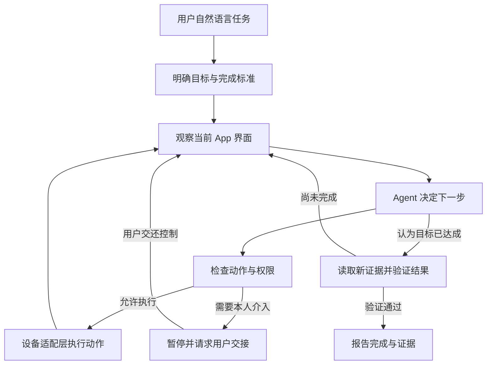

# Sidecar（伴行）

通过自然语言驱动真实 App 界面操作的手机 Agent，旨在让用户正常使用手机的同时，由分身完成任务，不干扰前台操作。

> 技术方案：[Sidecar 技术方案 v0.5（2026-10-15）](docs/technical-proposal.md)。精简说明当前架构、副屏操作、轻量 DDD、完成门禁与验证证据，附真实代码片段和源码链接。

> 早期核心里程碑：第一版 Agent Harness 核心通过了当时的 32 项自动化测试，提供本地离线演示与可配置模型适配器。这是历史阶段记录，不表示当前新增功能已全部验收。

**DeepSeek 接入已加入代码：** 配置 `deepseek-flash`，使用 JSON 模式并在本地校验结构化结果；详见 [DeepSeek 配置与验证说明](docs/deepseek.md)。2026-10-12 已实际调用模型并操作 Mac 上 Android 模拟器中的 Google 时钟；具体联调结果见该文档，不代表所有 App 均已验收。

## 当前演示入口

本次选定 **Google 时钟设置闹钟**：真实模型驱动隐藏副屏，创建并开启 23:58 闹钟的单次实测已完成（约 76 秒、7 次决策）。完整启动、录屏、结果核对与证据导出见 [Google 时钟 Demo 指南](docs/clock-demo.md)。闹钟仅在该 Android 模拟器内生效；正式同期录像仍需展示用户持续操作。生产化后续思路见技术方案第 16 节。

## 当前可运行的内容

- 基于 LangGraph 的单 Agent 观察、决策、执行、交接与验证流程。
- 有类型的 GUI 动作、设备策略检查、操作前页面变化检查。
- SQLite 检查点、任务状态、控制请求、事件记录和动作意图日志。
- 在步骤边界暂停、取消；用户交还控制或崩溃恢复后重新观察。
- 动作结果不确定时等待用户核对；同一工作目录中的未结束任务保留环境使用权。
- 决策步数、无进展轮数与每次运行时间限制；只向模型提供最近八条动作摘要。
- 可配置的 LangChain 模型适配器，以及无需密钥的规则演示。

**离线演示是文字状态模拟，不是真实手机界面，也不是具备自然语言泛化能力的 Agent。** 它用于验证 Harness 的运行机制。真实模型模式使用同一个演示环境，可以测试模型决策，但仍不等于完成真实 App 验收。

## 本地运行

需要 macOS 或 Linux、Python 3.11+。当前开发环境为 macOS、Python 3.14；本地执行锁使用 Unix 文件锁，暂不支持 Windows。

```bash
python3 -m venv .venv
source .venv/bin/activate
python -m pip install -e '.[dev]'
sidecar demo --item '复习项目架构' --item '检查提交材料'
```

命令返回任务 ID、状态、验证结果及 `mode: offline_demo`。运行数据保存在 `.sidecar/`，已排除在 Git 之外。重复运行使用同一份演示清单，已有目标事项不会再次创建。

CLI 的 `demo` 命令和服务配置的 `mode="demo"` 均使用 `offline.py` 中的离线模拟设备与策略；`offline` 是内部模块名，现有命令和配置名保持兼容。

`requirements-lock.txt` 记录本次验证环境的依赖版本。如需复用这些版本，将安装命令改为 `python -m pip install -c requirements-lock.txt -e '.[dev]'`；它是版本快照，不包含安装包哈希。

### 查看记录与模拟交接

将 `<任务ID>` 替换成运行结果中的 `task_id`；`--home` 位于子命令之前。

```bash
sidecar status <任务ID>
sidecar events <任务ID>

# 在单独的演示目录中模拟需要用户登录的场景
sidecar --home .sidecar/handoff demo --require-login --item '整理材料'
sidecar --home .sidecar/handoff demo-login
sidecar --home .sidecar/handoff resume <任务ID> --note '已在演示环境中完成登录'
```

`demo-login` 仅改变离线演示状态，不涉及任何真实账号。恢复备注应说明已核对的结果；恢复不会重放被暂停的旧动作。进程中断后，也可以通过 `resume` 在人工核对后恢复。

运行任务时，可从另一个终端请求控制：

```bash
sidecar pause <任务ID>
sidecar cancel <任务ID>
sidecar resume <任务ID> --note '已检查当前页面，继续'
```

暂停和取消在步骤边界生效，不能撤回已经开始的设备动作。取消请求不会被后来的暂停或恢复请求覆盖。已完成、失败或取消的任务不能继续。未结束的任务会阻止同一工作目录启动另一项任务。

### 接入真实模型（可选）

只有显式添加 `--llm` 并配置以下环境变量，才会调用模型。CLI 不自动读取 `.env` 文件。

- `SIDECAR_MODEL`：模型名称。
- `SIDECAR_API_KEY`：对应提供商的密钥，不要写进代码或提交 Git。
- `SIDECAR_BASE_URL`：可选的兼容接口地址；不设置时使用 ChatOpenAI 默认端点。

```bash
sidecar --home .sidecar/model-demo demo --llm \
  --goal '请把整理演示视频加入待办，保存后检查结果' \
  --item '整理演示视频'
```

`--goal` 是自然语言目标，`--item` 定义本演示的明确验收条件。一般接口使用 JSON Schema 输出；官方 DeepSeek 接口使用 JSON 模式、提示词中的输出契约及本地校验。使用截图时还需支持图像输入。不同兼容接口需要分别验证，不能仅凭 API 格式相似保证可用。

模型模式会向配置的提供商发送任务、当前观察和最近的动作摘要。本地 Harness 禁用继承自全局环境的 LangSmith 追踪。截图可作为内联图像接入，但当前演示仅提供文字观察；Android 模式发送允许页面的截图和控件信息，识别到敏感页面时停止交接。

### 开发检查

```bash
python -m pytest -q
ruff check src tests
ruff format --check src tests
```

### 接入 Cherry Studio 等 OpenAI 兼容客户端

Sidecar 提供 `/v1/models` 与 `/v1/chat/completions` 两个 OpenAI 兼容端点，可被 Cherry Studio 当作一个「模型」调用。

启动服务（自动拉起独立 worker，浏览器关闭不影响任务）：

```bash
sidecar --home ~/.sidecar serve
# 打印访问地址和配对码；配对码即 API Key
```

在 Cherry Studio 中添加自定义提供商：

| 配置项 | 值 |
| --- | --- |
| Base URL | `http://127.0.0.1:8765/v1` |
| API Key | 启动时打印的配对码 |
| 模型 | `sidecar-agent` |
| 对话接口 | OpenAI / Chat Completions |
| 流式输出 | 支持，可开启 |

请使用「添加自定义提供商」中的 OpenAI 端点，确认界面显示的请求路径是 `/v1/chat/completions`。部分版本的内置 OpenAI 提供商默认使用 Responses 接口；Sidecar 尚未实现 `/v1/responses`，使用该接口会返回 404。

在对话里发送任务描述，Sidecar 执行后在回复中返回结果。需要本人介入（登录、验证码、支付）时，回复会提示 `继续 <任务编号>`，在同一对话里回复该指令即可恢复任务。

任务回复带任务编号（响应 JSON 另有 `task_id` 字段）。等待超过 120 秒后，发送 `查询 <任务编号>` 可立即查看状态；`queued` 表示尚未执行，会说明阻塞任务。查询不会恢复或创建任务。

聊天控制指令每次单独发送一条：

| 指令 | 作用 |
|---|---|
| `取消 <编号>` / `停止 <编号>` | 结束任务，不撤销已执行的操作 |
| `暂停 <编号>` | 请求在步骤边界暂停 |
| `继续 <编号>` / `恢复 <编号>` | 核对现场后恢复，不授权自动发送或支付 |
| `查询 <编号>` / `状态 <编号>` / `进度 <编号>` | 只读查询 |
| `任务列表` / `查看队列` | 查看近期 50 条任务及阻塞情况 |
| `清空队列` / `清除任务队列` | 取消当前全部未结束任务，保留历史记录 |
| `帮助` | 查看指令用法 |

命令行使用 `sidecar --home .sidecar clear-queue`，`--home` 应与服务的运行目录一致。
清空覆盖全部未结束任务，不受列表 50 条上限限制；执行中的任务在步骤边界响应取消。
返回数量区分已取消与等待取消的任务。历史记录和执行证据保留，已执行的操作不会撤销。
聊天清空指令必须单独发送，回复不会创建新任务。

支持 `取消 Gmail 的任务<编号>`、`查看任务<编号>的进度` 等表达，控制时以完整的 32 位任务编号为准，无需重新识别目标 App。缺少编号或包含多个编号的控制请求会提示补充，不创建任务；否定句、引用或附带其他说明的消息不会触发控制。帮助和列表不创建任务，响应的 `task_id` 为 `null`。暂停和取消正在执行的任务时，回复会说明请求尚待生效；等待介入的任务需继续或取消，才能解除后续任务的阻塞。

相同模型与完整对话的重试会复用原任务，包括服务重启后和任务已结束时。若需有意再次执行相同内容，请发起新的对话轮次，或在请求头中提供新的 `Idempotency-Key`；同一次提交的重试应保持该 key 不变。同一个 key 不能用于不同任务目标（返回 409）。去重记录保存在当前 `--home` 的任务数据库中。

**固定 API Key**：默认配对码持久化在 `--home` 目录下的 `pairing-token` 文件里，换目录启动会生成新 key。可用环境变量固定：

```bash
SIDECAR_PAIRING_TOKEN=你的固定key sidecar --home ~/.sidecar serve
```

或把 `SIDECAR_PAIRING_TOKEN=...` 写入 `.env` 并自行加载（项目不自动读取 `.env`，见 [.env.example](./.env.example)）。

支持**流式和非流式**返回。`stream=true` 使用 OpenAI 兼容的 SSE：先返回任务编号，再推送任务状态变化和最终验证结果；等待期间定期发送心跳，最后发送结束标记。`stream_options.include_usage=true` 会附带用量块（当前计数为 0，未统计模型消耗）。`stream=false` 保持原有的完整 JSON 回复。两种方式均最多等待 120 秒，超时后可按编号查询；关闭聊天连接不会取消后台任务，切换流式开关重试也不会重复创建任务。

流式内容是任务进度与结果，不是模型的内部推理或逐 token 输出。当前 demo 模式把每条普通用户消息当作待办任务，不支持日常闲聊；回复会明确标注“离线演示模式”，完成时只表示这条文字已在本地模拟待办中验证。比如“设置晚上 9 点的闹钟”只会被记录为文字，**不会设置真实闹钟**，也不会订酒店或操作手机。请用“创建一个复习项目架构的待办”验收。

### 在 Mac 的 Android 模拟器里操作真实 App

启动模拟器，安装目标 App，确认 `adb devices` 显示设备在线。在当前终端配置上述模型环境变量（使用自己的 `.env` 时须显式加载），安装设备依赖后启动：

```bash
python -m pip install -e '.[android]'
# Homebrew Android command-line tools 的常用位置；其他安装方式请用实际 SDK 路径
export PATH="/opt/homebrew/share/android-commandlinetools/platform-tools:$PATH"
sidecar --home ~/.sidecar/android-clock serve --android \
  --serial emulator-5554 --package com.google.android.deskclock --port 8766
```

Cherry Studio 的 Base URL 对应为 `http://127.0.0.1:8766/v1`，模型仍为 `sidecar-agent`，API Key 使用该运行目录的配对码或固定的 `SIDECAR_PAIRING_TOKEN`。不带 `--android` 启动默认是离线演示。

服务只操作「允许列表」内的 App。单 App 用 `--package`；需要多 App 时用 `--allowed-packages`（逗号分隔）指定白名单，`--package` 成为任务未指定目标时的默认项：

```bash
# 多 App：微信读书与 Microsoft To Do，默认目标是微信读书
sidecar --home ~/.sidecar/android-work serve --android --hidden-display \
  --serial emulator-5554 --port 8766 \
  --allowed-packages com.tencent.weread,com.microsoft.todos \
  --package com.tencent.weread
```

Cherry Studio 请求现在会在入队前，根据任务中明确出现的应用名称选择目标。例如“在 Notion 中创建页面”和“在微信读书搜索西游记”会分别选择对应 App，不会继续沿用上一项任务的软件。目标未获允许、提到多个 App，或多 App 配置下没有明确目标时，会要求补充说明，不创建任务。一项任务目前只操作一个 App。

聊天路由按逗号、中文句号、分号、问叹号或换行划分分句，含“不要”“不用”“别用”等常见否定表达的分句不提供目标 App。例如“不要打开时钟，在微软待办创建任务”会选择微软待办。只有一个允许的 App、该 App 未被否定且还有肯定分句时，可以回退到默认目标；多个候选或前后矛盾时需明确指定。这是保守的文本规则，不是完整的语义理解；否定与肯定意图混在同一分句时，请改写或通过控制台选择目标 App。

内置名称识别包含 Notion、微信读书/微信阅读/WeRead、时钟/闹钟/Clock、Microsoft To Do/微软待办；它们不是软件支持上限。允许列表和别名配置各支持最多 256 个应用。名称重叠时优先匹配完整的长名称，例如 YouTube Music 不会同时匹配 YouTube；肯定语境中出现多个允许的应用时仍要求拆分任务。新增安装的软件需要加入允许列表并配置别名，不会自动授权。其他 App 可以通过包名指定，也可重复传入 `--app-alias 包名=名称` 配置聊天中使用的名称。例如：

```sh
sidecar --home ~/.sidecar/android-clock serve --android --hidden-display \
  --serial emulator-5554 --port 8766 --package com.tencent.weread \
  --allowed-packages com.tencent.weread,notion.id \
  --app-alias notion.id=Notion
```

副屏任务完成、失败或在执行期间取消后，worker 会关闭属于该 App 的副屏任务窗口，再领取下一项任务。退出操作核对显示屏和窗口归属，不使用全局强制停止；发现同一 App 也在其他屏幕上或窗口归属混杂时，会保留窗口并记录提示。暂停、等待用户接管或结果不确定的中断会保留现场。关闭窗口不代表清除 App 数据；完成前仍需要验证用户要求的修改已保存。

提交任务时可带 `app` 字段指定本任务的目标 App（必须是允许列表内的包名）；网页在允许多个 App 时会显示「目标 App」下拉。任务级 `app` 越界会在提交阶段被拒绝（HTTP 409）。观察到的前台 App 不在允许列表、或不是本任务目标时，一律交接给用户，不会误操作其它 App。

新任务会打开该任务的目标 App；暂停恢复时保留现场并重新观察。密码、登录、验证码及账号注销页面仍需人工接管。发送、支付、转账、发布等最终提交控件改为动作级拦截：页面上出现按钮不会阻止填写独立字段，但 Agent 不会点击该按钮或与其重叠的控件，也不会用坐标、滑动、返回或无目标输入绕过检查；删除入口沿用同样的区域隔离。无法定位敏感控件时仍交接。这些是保守的界面规则，不是对任意 App 的完整风险识别保证。加入允许列表的每个 App 仍需单独验证其界面规则。模拟器闹钟只在模拟器内生效，不会设置 iPhone 的系统闹钟。

涉及最终提交的任务会先核对准备内容。只有准备项有可见证据通过、剩余项确实仅需用户最终提交时，才提示“准备已完成，最终操作未执行”，保留现场等待用户操作；未通过的准备项会明确列出。回复“继续”只会重新观察和核对，不会授权 Agent 点击发送或支付。仅要求保存草稿的任务，在确认草稿已保存且未发送后正常完成，不要求用户发送邮件。

设备写入 RPC 不自动重发；结果不确定时需核对现场。界面读取允许恢复连接。更新代码或模型环境后，应先暂停或结束活动任务，再重新启动原执行进程；仅重开终端不会更新已运行的 worker。

运行期观察故障会显示分类中文提示，如“界面读取失败”“截图失败”“读取期间页面发生变化”。任务的 `error` 事件保存 `stage`（具体失败阶段）、`node`（当时的执行流程节点）和异常类型，不保存原始异常正文。设备连接、执行屏校验、前台应用读取、连接释放及读取通信超时也分别分类；未知故障保留流程节点供排查。连接释放异常不会覆盖先前的读取失败。已有历史任务中的泛化报错无法据此还原，更新并重启执行进程后新发生的错误才会记录这些信息。

### 同一模拟器：主屏自用，Agent 使用隐藏副屏（实验性）

已在本机 Android 15 模拟器验证：YouTube 留在主屏播放，Google 时钟在同一 Android 实例的虚拟副屏中运行。副屏不会打开 Mac 镜像窗口；控制台默认隐藏截图，点击“查看执行画面”才加载最近观察。这是截图预览，目前还不提供副屏的鼠标接管面板。

需要 `adb`、`scrcpy`（本次验证版本 5.0.1）和 `ffmpeg` 位于 PATH，且已加载模型环境变量。Mac 可通过 `brew install scrcpy` 安装后两者。启动：

```bash
sidecar --home ~/.sidecar/android-clock serve --android --hidden-display \
  --serial emulator-5554 --package com.google.android.deskclock --port 8766
```

所有截图、控件和触摸都绑定副屏；目标 App 来自任务的 `app` 字段或默认 `package`，且必须落在允许列表内。程序核对显示屏编号、唯一标识和 Android 本次启动标识；副屏失联时停止，不回退主屏。如果你正在主屏使用同一个目标 App，Agent 拒绝将它移走。

副屏文字输入通过随包附带的 Android 桥接程序，对明确指定的可编辑控件执行 `ACTION_SET_TEXT`，替换该字段文字并读取验证。不点击抢焦点、不调用键盘或剪贴板。已用独立测试 App 验证中英文输入、主副屏同名输入框隔离及主屏同时打字；定位过期、匹配不唯一、密码框或不支持该动作时停止，不自动改用焦点输入，也不重发结果不确定的写入。自定义控件仍需逐 App 验证，支付等原有限制继续生效。桥接源码、重建方法和模拟器验收步骤见 [Android 输入桥接说明](android/textbridge/README.md)。

服务结束时副屏也会销毁，其 App 界面会关闭，已保存的 App 数据保留。重启前应结束当前任务；崩溃遗留任务可在服务离线时取消，再重新启动：

```bash
sidecar --home ~/.sidecar/android-clock cancel <任务ID>
```

不能把旧副屏上的暂停任务直接恢复到新副屏；应核对已产生的结果后提交新任务，避免重复写入。主副屏仍共享账号、音频和部分系统能力，本轮没有验收 Amazon、登录/支付或任意 App 的隔离效果。

## 设备权限与普通用户落地

### 当前原型使用的权限

当前演示使用 **Mac 上的 Android 15 模拟器 + 已授权的 ADB 连接 + 隐藏虚拟副屏**。项目代码不要求执行 `adb root` 或 `su`，不要求系统签名、解锁 Bootloader、修改 ROM 或 iPhone 越狱。这是当前实现的权限需求说明，不代表已经在所有非 Root 真机上完成验收。

| 能力 | 当前使用方式与前置条件 |
| --- | --- |
| 设备连接与控制 | 由宿主 Mac 通过 ADB 连接 Android；使用真机时需用户开启开发者选项、USB 调试并授权该电脑，设备策略也必须允许调试 |
| 获取界面与执行动作 | 使用 uiautomator2 / UiAutomation 和 ADB shell；执行端 App 由用户安装并完成账号登录 |
| 隐藏副屏 | scrcpy 创建虚拟显示屏；当前代码要求 Android 15（API 35）或以上，已验证环境为本机模拟器 |
| 副屏定向输入 | 通过 ADB 将随包分发的 `textbridge.jar` 放入 `/data/local/tmp/`，再用 `app_process` 在 shell 环境执行；利用 UiAutomation 定位控件并设置文字 |
| 系统内部接口 | 输入桥接初始化使用 Android 隐藏 API；它不是仅靠普通 App 运行时权限即可获得的能力，系统或厂商版本变化后须重新验收 |

桥接程序本身不安装常驻输入法或无障碍 App，也不监听网络端口；这不等于整个设备工具链没有辅助组件。当前授权来自 ADB 调试链路，不能将其表述为“用户从应用商店安装一个普通 App 就能无授权控制其他 App”。主副屏仍共享账号、音频和部分系统能力，焦点、输入法及系统弹窗的隔离需在目标设备和 App 上验证。

### 普通用户如何使用

**近期方案：配对一个由用户控制的桌面执行端。** 用户在 Mac 上准备 Android 执行环境，安装目标 App 并亲自登录；Sidecar 在桌面端运行，手机通过可信局域网中的网页提交任务、查看进度、暂停或取消。Android 模拟器承担 App 操作，因此用户日常手机不需要 Root 或越狱。当前仍需手动配置环境；一键安装、初始化向导和更方便的人工接管属于后续产品化工作，不能作为已实现能力。

结果必须明确归属执行端的 App 和账号。若要在日常手机中使用结果，应选择支持同账号同步的 App，并实际验证同步；当前 Google 时钟演示创建的是 Android 执行实例内的闹钟，**不会变成 iPhone 的系统闹钟**。

**同机 Android 真机路线：待验证的扩展。** 可以在用户主动授权 ADB 的测试真机上评估同机副屏，但必须逐项验收厂商系统、虚拟显示、隐藏 API、触摸与键盘焦点、目标 App 兼容性以及调试授权的生命周期。目前不能承诺脱离电脑后持续可用，也不能承诺任意普通手机安装即用。如果未来改用系统签名、Root 或定制 ROM，需要单独记录新增权限与部署成本；当前项目没有采用这些路径。

答辩时可概括为：**原型通过用户授权的 ADB 获得开发者级设备控制能力，在独立副屏操作真实 App；近期以桌面执行端配合手机入口落地。同机普通真机的广泛兼容和免配置体验尚需验证。**

## 代码结构与设备接入

| 文件 | 内容 |
| --- | --- |
| `src/sidecar/contracts.py` | Task、Observation、Action、Verification 及设备/模型接口 |
| `src/sidecar/lifecycle.py` | 任务生命周期、控制优先级、恢复与对账纯规则 |
| `src/sidecar/execution_control.py` | 不依赖图、设备和模型的执行控制服务 |
| `src/sidecar/harness.py` | LangGraph 执行、交接、恢复和验证流程 |
| `src/sidecar/store.py` | SQLite 任务索引、控制请求、事件和动作日志 |
| `src/sidecar/jobs.py` | 持久任务队列与执行配置 |
| `src/sidecar/worker.py` | 独立执行进程，浏览器断开不取消任务 |
| `src/sidecar/server.py` | 网页控制台与 REST API |
| `src/sidecar/openai_compat.py` | OpenAI 兼容端点，供 Cherry Studio 接入 |
| `src/sidecar/model.py` | LangChain 结构化输出与受限上下文 |
| `src/sidecar/android.py` | Android 设备适配（uiautomator2） |
| `src/sidecar/android_rpc.py` | Android 一次性 RPC 子进程传输 |
| `src/sidecar/offline.py` | 明确标注的离线模拟设备与规则策略 |
| `src/sidecar/cli.py` | 运行、查看、交接、暂停、取消与 `serve` 入口 |
| `src/sidecar/static/` | 手机控制台前端 |
| `tests/` | 核心行为、模型边界、队列、服务与 OpenAI 端点测试 |

真实设备适配器需实现 `Device` 接口：稳定的 `device_id`，以及 `observe()`、`assess(action, observation)`、`execute(action)`。`observe()` 返回最新截图和/或界面元素；`assess()` 由可信适配器判定允许、拒绝或交接；`execute()` 执行一个有超时约束的动作。坐标点击使用 0–1 的归一化坐标，需由适配器换算。

Android 执行锁按设备编号跨运行目录互斥；仍须避免其他自动化工具或人工同时操作同一设备。设备 RPC 子进程每次有 30 秒超时，界面采集失败最多重试一次，写入不重试；任务总预算在步骤边界检查。

任务验收目前包含结构化逐项证据检查，不能保证模型对截图的判断一定正确；真实 App 接入后仍需增加针对目标内容的验证和跨端结果检查。SQLite 中保存的任务、动作文本及观察可能包含私人信息，应使用测试账号并按需清理运行目录。

设计与实施记录：[核心设计](docs/core-design.md)、[实施计划与审查结果](docs/superpowers/plans/2026-10-10-agent-core.md)。

## 项目目标

- 接受自然语言任务，根据实时界面决定下一步，能够处理加载、弹窗和页面变化。
- 在真实第三方 App 中完成多步操作，结果作用于用户自己的账号。
- 用户持续使用 iPhone 时，Agent 同时执行，不切换用户前台 App、不抢键盘和焦点。
- 用户可以查看实际执行画面、暂停、取消和接管任务。
- 遇到登录、验证码、支付等需要本人处理的步骤，保留现场并等待用户主动介入。
- 通过实际界面证据验证结果；等待交接时，明确已经完成的部分和剩余步骤。

首版建议聚焦一个用户、一个执行设备、一个第三方 App、一次一个任务。候选场景是创建清单和待办事项，具体 App 尚未确定。

## 任务生命周期的轻量领域建模

任务状态、取消优先级、恢复资格和重启对账决策集中在 `lifecycle.py`；`execution_control.py` 通过窄存储接口处理暂停与取消，队列不再为控制请求创建设备、模型或 LangGraph。Harness 继续负责观察与执行，Store 保留事务和执行锁。

队列负责调度与最终收尾，执行索引负责运行事实和证据，图检查点负责程序恢复位置；三者不是同一份状态，也没有跨库原子事务。恢复仍需核对现场、重新观察，检查点不授权重放旧动作。数据库格式与对外接口保持兼容。具体设计、取消竞争示例与测试方法见[技术方案：轻量 DDD 与恢复规则](docs/technical-proposal.md#3-轻量-ddd-与恢复规则)。

## Agent 架构

采用 **面向 GUI 的轻量 Agent Harness**，内部使用单 Agent 的 ReAct 风格观察—行动循环，底层由 LangGraph 管理执行。ReAct 描述决策方式；Harness 负责上下文、动作约束、交接、恢复、预算和验证，两者可以同时使用。

规划用于明确目标、约束和完成标准；每一步界面操作由最新观察决定。首版不预先写死完整点击序列，也不引入多 Agent 协作。



### 模块分工

| 模块 | 职责 |
| --- | --- |
| 目标规划 | 提取任务目标、约束和可验证的完成标准 |
| 观察 | 获取最新截图，按设备能力补充界面元素信息 |
| 决策 | 根据目标、当前界面、近期动作及其结果，选择下一步操作 |
| 执行控制 | 检查动作参数和权限，管理暂停、取消、超时和重试上限 |
| 设备适配 | 将观察、点击、输入、滑动等统一操作映射到具体设备工具 |
| 结果验证 | 使用新观察核对完成标准，保存证据，区分完成、失败和等待交接 |

这些模块不等于多个独立 Agent。首版可以由一个主要决策模型配合程序规则完成。

### 执行规则

- 每次改变界面后重新观察，避免依据旧截图连续操作。
- 模型提出动作，由程序检查后执行；界面中的文本不能自行成为新的用户指令。
- 用户接管期间停止 Agent 操作；交还控制后重新读取页面。
- 连续失败、重复停留同一页面或超过任务预算时，停止尝试并报告原因。
- 创建、发送等动作超时后，先核对是否已经成功，避免重复提交。
- 模型声明完成时进入验证阶段，验证通过后才能将任务标记为完成。

当前核心状态包括：`running`、`waiting_user`、`paused`、`completed`、`failed`、`cancelled`。验证作为图中的独立节点执行；待执行队列和面向用户的状态展示留待后续实现。

## 框架与技术选型

当前推荐：**使用 Python 开发，LangGraph 管理执行流程，按需使用 LangChain 的模型与工具组件，独立设备适配层负责操作 App。**

| 层次 | 当前建议 | 说明 |
| --- | --- | --- |
| 开发语言 | Python | 编写 Agent、后端和设备适配逻辑 |
| Agent 流程 | LangGraph | 显式组织观察、决策、执行、交接和验证流程 |
| 模型与工具接口 | LangChain 相关组件，按需引入 | 复用模型接入与工具定义能力 |
| 决策模型 | 待选 | 需要验证图片理解、动作输出、延迟、成本及目标 App 上的效果 |
| 后端接口 | FastAPI，暂定 | 接收任务、提供状态和控制入口 |
| 持久化 | SQLite＋本地截图文件，暂定 | 保存任务状态、检查点、操作记录与证据 |
| 手机入口 | 适配 Safari 的网页，暂定 | 提交任务、查看进度、请求暂停和处理交接 |
| 设备操作 | 依执行环境选择 | iOS 与 Android 路线仍在比较，不预先锁定工具 |

### 为什么使用 LangGraph，也保留 LangChain

LangChain 与 LangGraph 并非互斥选择。当前 LangChain 的 `create_agent` 建立在 LangGraph 上，也能使用持久化和人工介入能力。

| 方式 | 特点 | 在本项目中的考虑 |
| --- | --- | --- |
| LangChain `create_agent` | 通过模型、工具和中间件构建 Agent 循环 | 标准循环能满足需求时，可以采用 |
| 自定义 LangGraph | 明确定义节点、分支及状态转换 | 当前优先推荐，便于检查界面操作顺序、恢复逻辑和完成条件 |
| 自定义 LangGraph＋LangChain 组件 | 自定义流程，同时复用模型与工具接口 | 当前建议的组合方式 |

选择 LangGraph 的原因，是希望明确保证“动作后重新观察”“用户接管时停止”“提交超时后核对结果”“完成前验证”等执行规则。LangChain 也可以通过工具和中间件实现这些规则；两者的取舍在于流程控制方式，而非是否具备 Agent 能力。

如果采用自定义 LangGraph，首版不再额外嵌套完整的 `create_agent` 循环，以免产生两套难以追踪的循环与状态。

LangGraph 的持久化保存的是程序状态，不会让 App 界面回到过去。恢复时部分节点可能重新执行，因此仍需设计操作记录、结果核对和重新观察机制；框架不自动保证界面动作只执行一次。

## 执行环境：待确定

Agent 架构与设备控制实现分开设计。当前讨论方向是：**iPhone 作为日常使用与任务入口，Mac 或另一台设备提供独立的执行环境。**

| 候选路线 | 优点 | 必须验证的条件 |
| --- | --- | --- |
| iPhone＋Mac 上的 Android 模拟器 | 执行画面容易展示，便于调试 | 目标 App 安装、运行、登录、跨端同步和性能 |
| iPhone＋Mac 上的 iOS 模拟器 | 保留 iOS 界面环境 | 获得第三方 App 的模拟器构建，或能从源码编译并连接真实服务 |
| iPhone＋Mac 直接运行兼容 iOS App | 有机会使用正式发布的 iOS App | 开发者允许在 Mac 提供该 App，且可自动操作、同步结果；需明确其运行形态与题目要求的关系 |
| iPhone＋独立 Android 真机 | 使用真实手机环境 | 额外设备、自动操作能力和账号并存 |

iOS 模拟器不能按普通 iPhone 的方式直接安装任意 App Store App。模拟器版本与真机安装包的目标平台不同；Mac 直接运行兼容 iOS App 则属于另一种运行方式。

目前未验证在同一台未越狱 iPhone 内后台操作任意第三方 App、同时满足前台不受干扰的方案，因此不将其作为首版承诺。

题目允许模拟器、云手机或第二台设备。如果采用跨设备方案，需要清楚说明执行位置，并通过用户同一账号中的真实结果证明任务完成。统一设备接口也不意味着各平台可以直接互换，仍需分别适配和测试。

## 首版验收建议

1. 用户在 iPhone 上持续打字或浏览时，Agent 在独立环境中同期执行任务。
2. 演示同时展示用户操作和第三方 App 的真实执行画面，不仅展示进度文字。
3. 更换任务内容或初始页面后，Agent 能基于实时观察调整操作。
4. 执行端重新打开目标内容核对结果，并在 iPhone 同账号中检查同步情况。
5. 需要用户介入时，能够暂停、说明完成边界，并在交还控制后重新观察和继续。

以上是验收目标，尚无实测结果。任务是否能够跨端同步，取决于最终选定的第三方 App。

## 下一步需要共同确定

- 首个目标 App、任务内容与完成标准。
- 执行环境，以及安装、登录和跨端同步的可行性。
- 观察方式：纯截图，或截图结合界面元素信息。
- 模型选择、费用和任务时间预算。
- 手机端查看进度、暂停、取消、接管与通知的具体交互。
- 失败恢复、重复提交防护、凭据处理与日志保留规则。

通用核心已开始实现。上述产品与设备层设计达成共识后，再推进真实 App 接入和手机端交互；不会将离线演示作为题目要求的最终交付。

## 参考资料

- [LangChain 概览与 LangGraph 的关系](https://docs.langchain.com/oss/python/langchain/overview)
- [LangChain 人工介入机制](https://docs.langchain.com/oss/python/langchain/human-in-the-loop)
- [LangGraph 概览](https://docs.langchain.com/oss/python/langgraph/overview)
- [LangGraph 暂停与恢复](https://docs.langchain.com/oss/python/langgraph/interrupts)
- [LangGraph 持久化](https://docs.langchain.com/oss/python/langgraph/persistence)
- [Anthropic：Building effective agents](https://www.anthropic.com/engineering/building-effective-agents)
- [Apple：模拟器交互与 App 安装限制（归档文档）](https://developer.apple.com/library/archive/documentation/IDEs/Conceptual/iOS_Simulator_Guide/InteractingwiththeiOSSimulator/InteractingwiththeiOSSimulator.html)
- [Apple：在 Mac 上运行 iOS App](https://developer.apple.com/documentation/apple-silicon/running-your-ios-apps-in-macos)
- [Android Emulator 官方说明](https://developer.android.com/studio/run/emulator)

### 后台实时画面与执行录像

隐藏副屏任务现在会持续采集画面，并为每一轮执行/恢复保存独立录像。
控制台“查看执行画面”区分实时画面与历史截图；本轮结束后可下载录像。
媒体和结果报告均受配对令牌保护。录像保存在
`.sidecar/recordings/<任务编号>/<本轮会话>/`，不会默认上传到知识库。

需要 PATH 中的 adb、scrcpy、FFmpeg；非标准 scrcpy 安装可用
`SCRCPY_SERVER_PATH` 指定与 CLI 版本一致的服务端文件。当前实测 scrcpy 5.0.1。
普通观察复用视频流，执行前及最终验证仍使用独立新截图；视频本身不决定任务成功。
详见 [升级说明与验证边界](docs/video-upgrade.md)。


### 日常对话与时间查询

Android 模式下，OpenAI 兼容聊天接口会先理解消息：普通聊天直接回复，时间查询读取服务端真实时钟，明确的手机操作才创建任务。手机断开或 worker 停止不会阻止普通对话，但需要有效的模型配置与网络连接。默认时区为 `Asia/Shanghai`，可通过 `SIDECAR_TIMEZONE` 修改；也可以直接询问其他地区的时间。

网页中的“和伴行聊聊”使用相同的对话服务，保留当前浏览器会话的近期消息，断开连接时清除。“改成八点”等后续消息会结合对话中的任务编号理解；任务未结束或指代不明确时先澄清。原有结构化任务表单仍用于直接提交任务。

对话不会调用手机来回答一般问题，也没有接入天气或网页搜索。模型不可用或回复格式不正确时返回错误，不会自动改走手机操作。OpenAI 兼容端点的离线 demo 模式继续使用原来的模拟待办流程。

新增 `POST /api/chat`，沿用 Bearer 配对令牌鉴权：请求包含 `messages`（user/assistant 消息列表）、`request_id`（同一请求重试保持不变）和可选 `app`。返回 `message`、`status` 和 `task_id`；普通回复的 `task_id` 为 `null`，手机任务返回编号供现有任务接口查询。并发或重启后重试同一设备请求只创建一个任务，相同编号用于不同输入会返回冲突。
