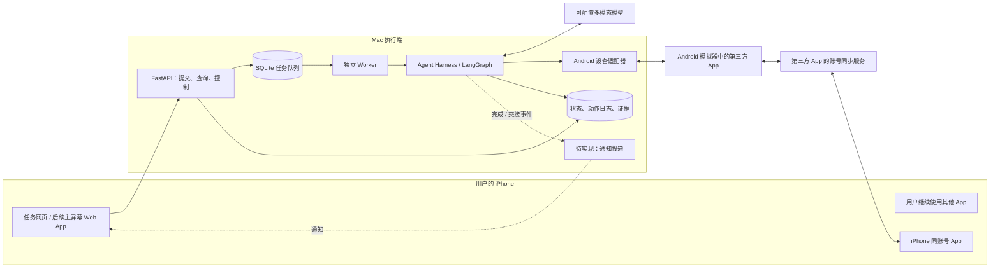
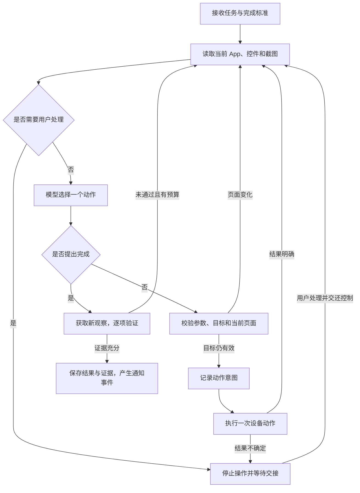
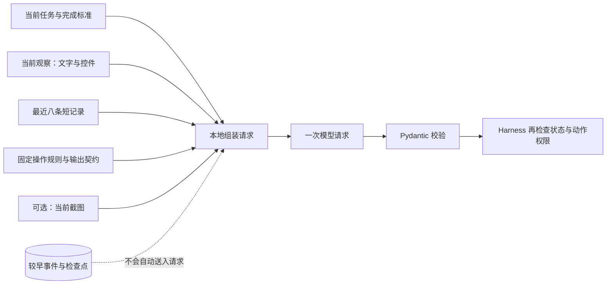
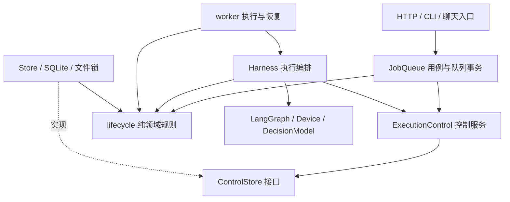

# Sidecar（伴行）技术方案

版本：v0.3 · 日期：2026-10-12 · 状态：供讨论与后续实施使用

> 2026-10-12 验证补充（一）：已连接真实 DeepSeek API 与 Mac Android 模拟器的 Google 时钟，完成 21:00 闹钟界面写入并以独立任务核对。已修复设备写入透明重试、目标 App 启动、控件编号漂移与勾选状态缺失，并实现 OpenAI SSE 输出。具体证据、调试中断及未验证范围见 [DeepSeek 联调记录](deepseek.md#5-2026-10-12-模拟器联调)。下文关于“尚未在线调用”和“设备重试尚未修复”的内容是 2026-10-11 历史状态；worker 生命周期、其他 App 及跨端同步仍未完成验收。

> 2026-10-12 验证补充（二）：隐藏副屏已支持**定向文字输入**——随包分发的 Android 桥接程序对明确指定的可编辑控件执行 `ACTION_SET_TEXT`，不依赖焦点、不调用键盘或剪贴板；已在模拟器实测副屏输入“西游记”并搜出结果，主屏前台 App 全程未变。同时把“单一目标 App”扩展为**允许列表 + 任务级目标 App**：服务只操作白名单内的 App，任务可指定本任务的目标 App，越界在提交阶段即被拒绝。回归测试 **163 项通过、1 项跳过**（跳过的为需要真实设备夹具的 live 验收），`ruff check src tests` 通过。详见[隐藏执行屏设计](superpowers/specs/2026-10-12-hidden-display.md)与 [Android 输入桥接说明](../android/textbridge/README.md)。

本文以项目题目、已有讨论及当前代码为依据。标为“已实现”的内容表示已有代码；只有明确列出验证证据的内容才表示已验证。本文不代表真实第三方 App 的端到端验收已经完成。

阅读导航：第 1–13 节说明产品路线、架构与交付；[第 14 节：Agent 运行机制](#runtime-details) 详细说明 State、长短期 Memory、上下文、工作区、工具、沙箱、MCP、事件、交互与恢复，以及未实现能力的取舍。

## 1. 项目定位与方案结论

Sidecar 是一个通过真实 App 界面完成任务的个人手机 Agent。用户在 iPhone 上提交自然语言任务后，可以退出任务页面，继续聊天或浏览；独立执行端负责观察界面、决定动作、完成操作、验证结果，并在完成或需要介入时通知用户。

首版采用：

**iPhone 网页入口 → Mac 上的任务服务与 Agent Harness → Android 模拟器中的真实 App → 同一账号的跨端结果。**

Agent 使用 **单 Agent 的 ReAct 风格循环 + 自定义 Harness + LangGraph 编排 + LangChain 模型适配**。手机端负责交互，Mac 负责执行，Android 承载第三方 App。

本方案实现的是用户体验上的并行使用。App 操作实际发生在独立 Android 环境，不是在同一台 iPhone 内后台操控另一个 iOS App。题目 FAQ 允许模拟器或第二台设备；提交材料仍须清楚披露执行位置、账号关系和部署成本。

首版的重点是跑通一个可验证、可接管的真实任务闭环。新意应体现在执行可靠性、交接体验和证据质量上，不能把独立设备路线本身当作已经证明的原创技术。

## 2. 需求、边界与首个任务

### 2.1 必须达到的行为

| 要求 | 方案中的实现方式 | 验收证据 |
| --- | --- | --- |
| 自然语言驱动 | 模型从任务提取完成标准，并逐步根据新界面决策 | 改变任务内容与初始页面后仍可运行 |
| 真实 App 操作 | 在 Android App 中点击、输入、滑动 | 同时录制实际执行画面 |
| 用户持续用机 | iPhone 前台与 Android 执行环境分离 | 用户持续打字、滚动，前台不被切换 |
| 页面退出后继续 | HTTP 服务与任务 worker 分离 | 提交后关闭页面，任务仍有执行记录和结果 |
| 可随时接管 | 暂停请求、停止确认、人工处理、带备注恢复 | 交接后重新观察，不继续旧点击 |
| 结果可验证 | 逐项界面核对，再检查 iPhone 同账号同步结果 | 清单、事项及明确的证据 |
| 完成后提示 | 页面内状态 + 后续 Web Push | iPhone 离开任务页面后收到通知 |

### 2.2 首版范围

一个用户、一个 Android 执行环境、一个登录账号、一份**允许列表内的多个 App**；支持多任务排队，每次只执行一个任务。暂不引入多 Agent、多设备并行或复杂长期记忆。

执行端只操作允许列表（`allowed_packages`）内的 App。每个任务可指定自己的目标 App（任务级 `app`），未指定时使用默认 `package`；目标越界会在提交阶段被拒绝。允许列表由用户在启动服务时配置，模型不能扩展。这取代了早期“一个服务固定一个 App”的限制。

目标 App 候选包括 **Microsoft To Do**（已在模拟器安装，登录与跨端同步待验证）与**微信读书**（已在隐藏副屏完成登录态读取、搜索输入与界面操作实测）。选择依据是任务结果容易描述、观察和人工核对，便于把多步操作串成可验证闭环。跨端同步仍需按 App 逐项本机实测。[Microsoft To Do 官方页面](https://www.microsoft.com/en-us/microsoft-365/microsoft-to-do-list-app)

建议首个任务：

> 创建一个叫“面试准备”的清单，加入“整理项目 README”“录制演示视频”“检查提交材料”三项待办。已有同名清单时使用现有清单，已有同名事项时跳过。

对应完成标准：

1. 目标账号中存在“面试准备”清单。
2. 清单中存在指定的三项待办，文字与要求一致。
3. 本次执行没有新增重复事项；已有重复数据应报告，不自动删除。
4. 在 Android 中离开并重新打开目标清单后，结果仍存在。
5. 在 iPhone 的同一账号中确认结果同步；该确认单独记录，不能由 Android 截图推断。

前四项用于执行端任务验证，第五项是最终演示的跨端人工验收。产品应区分“执行端已完成”与“跨端结果已核对”，不能让 Android 的完成状态隐含尚未发生的 iPhone 验证；这一区分也需要后续补入状态展示。

第一条真实设备里程碑可先缩小为“在现有清单添加两条待办”，通过后再加入新建清单与去重。登录、验证码、支付和删除不作为首个自动执行场景。

### 2.3 当前前置条件

- 用户设备为 iPhone 14 Pro；系统版本以实际设备信息为准，本方案不依赖未经核实的版本号。
- Mac 上已有 Android 15 模拟器，ADB 已能识别 `emulator-5554`；`adb`、`scrcpy`、`ffmpeg` 已就位；网络由用户确认已调通。
- 模拟器已安装 Microsoft To Do、微信读书与 Notion；微信读书已在隐藏副屏完成登录态读取与文字输入实测，To Do 的登录与双端账号同步尚未验证。
- 用户已选择 DeepSeek，已核对本机 `.env` 的配置格式，并以支持图片的 `deepseek-flash` 完成过真实在线调用。
- 用户手动完成登录；Agent 不保存密码，也不自动处理验证码。

## 3. 执行环境的选择

| 路线 | 适用价值 | 本项目的取舍 |
| --- | --- | --- |
| iPhone + Mac Android 模拟器 | 已有环境，便于观察、调试和录制 | 首版主路线；须验证 App 兼容、账号与同步 |
| iPhone + 独立 Android 真机 | 当模拟器不兼容时，可保留大部分设备接口 | 第一备选；需要额外设备和开发者授权 |
| 同一台 Android 的独立显示环境 | 更贴近同机并行体验 | 作为后续研究；焦点、输入法、系统权限和 App 兼容都需验证 |
| 同一台未越狱 iPhone 内后台操作第三方 App | 最贴近最初设想 | 目前没有已验证的实现路径，不列为首版承诺 |
| iPhone + Mac iOS 模拟器 | 适合有可用模拟器构建的 App | 当前未取得目标 App 的可用构建，不以此作为主路线 |

采用跨端方案后，“不抢手机焦点”主要来自执行环境分离。代价是 Mac 与执行设备必须保持运行，任务能否出现在 iPhone 中取决于 App 的同步机制。只保存在 Android 本地的结果不足以证明已作用于用户的 iPhone 使用体验。

普通用户落地路径：先提供可配对的 Mac 执行端，用户完成 Android 环境和账号初始化；后续再考虑独立 Android 设备或托管执行环境。托管方案会新增账号隔离、数据保护、费用和运维问题，不属于这次原型范围。当前路线不要求 iPhone 越狱，也不以 Android Root 或修改 ROM 为前提。

## 4. 总体架构



这里有两条不同的数据路径：Sidecar 的任务、控制与截图通过自己的服务流转；清单和待办由第三方 App 自己同步。Sidecar 不通过业务 API 或直接修改数据库代替 GUI 操作。

### 4.1 技术栈

| 层次 | 选型 | 选择理由 |
| --- | --- | --- |
| 后端与 Agent | Python 3.11+ | 延续现有代码，便于模型及 Android 工具集成 |
| Agent 编排 | 自定义 LangGraph 状态图 | 显式管理观察、操作、验证、交接和恢复 |
| 模型接入 | LangChain 的模型与结构化输出组件 | 隔离不同提供商接口，统一输出校验 |
| 数据契约 | Pydantic | 检查任务、动作和验证结果，拒绝无效参数 |
| Android 控制 | ADB + uiautomator2 | 获取真实界面、控件和操作能力 |
| API | FastAPI + Uvicorn | 提交任务与状态查询，复用已有实现 |
| 持久化 | SQLite | 适合单用户本地原型，减少部署组件 |
| 手机页面 | 原生 HTML / CSS / JavaScript | 保持入口简单，适配手机布局 |
| 后台执行 | 独立 Python worker | 不依赖浏览器或单次 HTTP 请求存活 |
| 完成通知 | HTTPS + Web App + Web Push，待实现 | 覆盖用户切换到其他 App 后的提示需求 |

LangGraph 官方将其定位为有状态 Agent 的底层编排能力，包含持久化与人工介入；本项目选择它是为了明确控制流程，而不是因为它能替代设备控制。[LangGraph 官方说明](https://docs.langchain.com/oss/python/langgraph/overview)

### 4.2 为什么这样组合

- **ReAct** 描述“观察后决定下一步动作”的循环。
- **Harness** 是围绕循环的运行管理层，负责权限、上下文、预算、动作日志、取消、恢复和证据。
- **LangGraph** 承担状态和流程编排。
- **LangChain** 提供模型适配与结构化输出。

这些概念分属不同层次。首版采用一个决策模型，通过明确的图节点工作，不另套一层独立 Agent 循环。

纯手写循环的启动成本低，但持久化、人工接管和崩溃恢复仍要自己建设。完整通用 Agent 框架可以加快常见工具任务开发，但本项目的关键约束是 GUI 动作的顺序和结果不确定性。沿用当前 LangGraph 核心，比迁移框架更有利于尽快验证真实 App。

首版不加入多 Agent：执行设备一次只能安全接受一组动作，多个决策者还会增加状态协调、延迟和费用。后续如有需要，可让独立验证器检查证据，但仍由单一执行者控制设备。

## 5. 从一句话到 App 结果

### 5.1 任务准备

网页提交原始目标，以及可选的明确完成标准。没有完成标准时，由模型提取可在界面中核对的条件；涉及账号、对象或数量歧义时，进入澄清交接，不自行扩大任务范围。

提取后的目标和完成标准要保存，恢复任务时继续使用原始版本。修改目标应视为明确的新请求，不能在恢复过程中悄悄重新规划。

### 5.2 每一步的执行循环



模型可输出 `tap`、`type`、`swipe`、`back`、`wait`、`handoff`、`finish`。每个输出都要有结构化参数及简短理由；模型不能直接执行任意终端命令、读取主机文件或选择未授权设备。

模型提出 `finish` 只代表申请验证。完成状态必须来自新的界面证据，覆盖全部完成标准。使用同一个模型单独验证有助于规范流程，但不构成独立正确性证明；关键结果还需确定性控件检查和人工跨端核对。

### 5.3 App 适配的粒度

核心循环保持通用。每个 App 可以有一个轻量配置，包含允许的包名、启动条件、常见敏感页面、术语和验收方法；具体下一步仍从实时界面产生。

例如 To Do 的适配可以说明如何区分“清单标题”和“待办标题”，以及如何回到目标清单验证。它不应保存“先点坐标 A、再点 B、再点 C”的完整固定脚本。后续扩展 App 时，要重新验证界面识别、登录、敏感操作和结果同步，不能承诺配置包名后就通用。

## 6. Android 的观察与操作

`AndroidDevice` 统一提供 `observe`、`assess`、`execute`，并可提供动作前的有效性检查和设备锁。uiautomator2 在 Python 端调用 Android 自动化能力；项目在其外增加超时、目标约束和动作结果记录。[uiautomator2 官方仓库](https://github.com/openatx/uiautomator2)

观察内容包括前台 App 包名、页面标识、界面文本、可操作控件及截图。优先使用控件信息定位，截图补充视觉关系；没有可靠控件时才使用坐标操作。中文输入优先走文本控件接口，并在输入后重新读取界面核对。

在隐藏副屏上，文字输入通过随包分发的 Android 桥接程序完成：它用 UiAutomation 的多显示屏窗口枚举定位到**明确指定**的可编辑控件，执行 `ACTION_SET_TEXT` 并读回验证。它不依赖系统焦点、不调用键盘或剪贴板，因此不会抢走用户在主屏的输入。选择器包含控件原文字，写入成功后旧选择器失效；匹配不唯一、字段变化、密码框、不支持该动作或副屏身份变化时停止，不自动退回焦点输入，也不重发结果不确定的写入。

动作前重新观察：目标的文字、类型、位置或所属 App 改变时，放弃旧动作。纯坐标操作采用更严格的界面检查。截图和控件读取并非原子操作，即使连续检查也无法消除所有页面瞬时变化，因此执行后必须再次观察。

执行端只允许操作允许列表内的 App，每个任务绑定一个目标 App；如果跳到登录页、系统弹窗或其他 App，应停止并要求介入。允许列表限制能力范围，但不能证明包内所有按钮都安全。敏感检查须覆盖完整控件树，不能因为模型输入最多保留 200 个控件就提前结束安全检查。

**禁止不确定写操作的透明重试。** 点击“保存”之后通信超时，可能已经产生结果。Harness 和底层设备库都必须遵守这条规则；只在重新观察并确认安全后再作新决定。当前安装的设备库存在失败后重发 RPC 的路径，需要在真实写入联调前处理。

## 7. 后台任务、暂停和恢复

### 7.1 为什么使用独立 worker

HTTP 请求只负责保存任务并返回 ID。worker 独立领取任务和调用 Harness，因此关掉网页不会取消任务。关闭服务入口也不应直接杀死正在执行的 worker；Mac 睡眠、关机、设备断连和 worker 崩溃则是不同的故障，需要恢复流程。

FastAPI 的后台任务机制可以处理请求后的工作；本项目选择独立进程，是为了隔离网页服务与执行生命周期。这是项目架构选择，单独部署的持久任务也需要额外调度机制。[FastAPI Background Tasks](https://fastapi.tiangolo.com/tutorial/background-tasks/)

### 7.2 用户可见状态

| 状态 | 含义 | 下一步 |
| --- | --- | --- |
| 排队中 | 请求已保存，尚未占用设备 | 等待、取消或暂停 |
| 准备执行 / 执行中 | 提取标准、观察或操作设备 | 请求暂停或取消 |
| 已暂停 | Agent 已停止自动操作 | 用户核对后恢复或取消 |
| 等待用户 | 登录、验证码、歧义或不确定操作需要处理 | 说明已完成部分和交接事项 |
| 执行中断 | worker 意外退出，现场可能已有变化 | 人工核对后恢复或取消 |
| 已完成 | 本次任务完成标准已验证通过 | 查看证据和同步状态 |
| 未完成 | 超出预算、无法继续或发生错误 | 查看原因，决定是否新建任务 |
| 已取消 | 不再发出新的操作 | 已执行的修改不会自动撤回 |

暂停与取消在步骤边界生效。用户点击“暂停”后，页面先显示“正在停止”，确认停止后才能接管。已经发出的设备动作不能保证撤销。取消一旦被接受，不得被后续暂停、异常回写或恢复操作覆盖。

同一执行环境串行运行；暂停和交接期间保留该任务的环境，阻止后续任务改变现场。现有工作目录锁与设备活动执行锁需要统一管理，不能宣称目前已实现跨所有工作目录的持久设备预留。

### 7.3 持久化与防重复

保存任务目标、完成标准、状态、用户控制请求、近期事件、检查点、动作意图和结果证据。队列与图状态之间还要做恢复对账，避免页面显示完成而 worker 仍认为任务执行中。

每个动作执行前先保存意图，执行后记录确定结果；发生超时或崩溃时，把未确认动作标记为不确定，禁止自动重放。恢复入口要求用户核对现场，并从新的观察继续。提交任务使用幂等编号；客户端重试同一次提交时应复用原编号。

GUI 操作和本地数据库不在同一个事务中，因此本方案不承诺所有外部修改“恰好一次”。去重依赖动作日志、App 当前结果检查与必要的人工确认。LangGraph 检查点保存程序状态，不会让手机页面回到旧状态。[LangGraph 持久化说明](https://docs.langchain.com/oss/python/langgraph/persistence)

## 8. 手机入口、执行画面与通知

手机页面包括自然语言输入、任务列表、状态、最近执行画面、简短操作记录、结果证据，以及暂停、取消和交还控制按钮。前期用每两秒查询状态的方式，减少实时连接管理成本；这个刷新周期不是动作完成时间保证。

当前画面接口展示最近一次写入任务状态的观察截图，不保证覆盖每次执行前的观察或失败验证现场。它不等于连续实时视频，模型思考期间画面可能没有更新。提交演示时，应同时录制 Android 模拟器的实际运行窗口；后续可以增加独立、受权限控制的画面采集通道，并标明采集时间和画面是否过期。

### 8.1 关闭页面后的完成提示

最终方案采用安装到 iPhone 主屏幕的 Web App，配合 HTTPS、Service Worker、Push 订阅和服务端投递。用户主动点击“开启通知”后申请权限。iOS 的主屏幕 Web App 支持 Web Push，权限申请需要用户交互触发。[WebKit 官方说明](https://webkit.org/blog/13878/web-push-for-web-apps-on-ios-and-ipados/)

任务完成、失败或等待用户时，先保存状态及通知事件，再异步投递。通知失败不能把已完成任务改为失败；页面重新打开后以数据库状态为准。计划使用待投递记录、去重标识和有限重试，处理服务重启与网络失败。

推送默认只显示“任务已完成”或“需要你处理”，避免在锁屏泄露清单内容。系统通知权限、专注模式、网络与订阅有效性会影响展示，不承诺必达或即时到达。拒绝权限时，退化为页面内状态和回到页面后的提示。

**当前只有页面内提示，Web Push 尚未实现，也未在用户的 iPhone 上验证。** 这项能力应放入产品闭环阶段，而不是用“网页会刷新”代替。

### 8.2 访问与连接

开发默认只监听 Mac 本机。iPhone 访问时需要明确的可达地址，不能使用指向手机自身的 `127.0.0.1`。同一局域网可做连接调试；正式手机演示建议通过 HTTPS 反向代理提供入口，Android 与 ADB 仍留在本机。

API 使用配对令牌，状态、截图、控制接口都要求认证。普通 HTTP 的令牌会面临传输泄露风险，不应在不可信网络中使用。公网方案还须补齐令牌轮换、访问限制和推送订阅保护；目前没有完成公网部署。

## 9. 模型选择、预算和数据边界

用户已选择接入 DeepSeek，首个候选为 `deepseek-flash`，配置方法与已验证边界见 [DeepSeek 接入说明](deepseek.md)。官方接口采用 JSON 模式并由本地校验输出，其他兼容接口继续使用 JSON Schema 模式。当前适配器使用 ChatOpenAI 接口；“兼容 OpenAI API”不保证图片格式、结构化输出和超时行为完全兼容，需要逐个验证。模型在真实 App 上的效果尚待实测。

先用相同的一组录制界面测试候选模型，再在真实 App 中比较：动作是否合法、控件定位是否正确、是否随意宣告完成、任务完成率、耗时与费用。确定一个主模型后固定模型标识、提示词版本、App 版本和测试环境，避免同时改变多个变量。

首版 Android worker 当前配置为每次运行最多 50 次决策、600 秒；单次模型请求超时 30 秒，决策与验证遇到暂时连接故障最多尝试两次。它们是初始配置，不是服务承诺。后续应增加跨恢复累计预算，避免反复恢复绕过上限；规划阶段也需纳入控制和计量。

发送给模型的内容限于任务、完成标准、当前必要的观察和短历史。不需要把整段执行录像或全部历史截图送入上下文。事件日志记录简短动作理由，不要求模型输出隐藏推理过程。

登录、密码、验证码等页面优先交给用户；脱敏与敏感检查无法保证识别一切私人内容，真实账号联调前须检查截图与文本路径。密钥从本机环境读取，不写入仓库；模型入口禁止意外继承第三方追踪。DeepSeek 接入时已将规划、决策和验证调用统一放入关闭 LangSmith 追踪的上下文，并添加回归测试。

SQLite 中的任务、观察与动作可能包含私人内容。目前未实现数据库加密及自动保留期限。首轮使用内容可公开的测试清单，之后补充历史清理、截图保留策略和结果导出。

## 10. 当前实现状态与未完成事项

以下为 2026-10-12 的工作区快照，并非完整发布状态。

| 模块 | 当前状态 | 下一项验证或补齐 |
| --- | --- | --- |
| LangGraph Harness | 已有观察、决策、执行、交接、验证与持久化代码 | 继续补齐真实设备和并发边界 |
| 离线演示 | 可验证任务流程、状态与恢复 | 明确保留“模拟”标签 |
| Android 适配器 | 已有控件树、截图、基础动作与副屏定向文字输入代码 | 各 App 的界面规则逐项验证 |
| 隐藏副屏（实验性） | 已实现副屏创建、身份绑定、定向输入与截图；已实测主屏前台不受影响 | 更多 App 与系统弹窗场景 |
| 多 App 允许列表 | 已实现 `allowed_packages`、任务级目标 App 与越界拒绝 | 逐 App 验证与配置说明 |
| 手机网页与 API | 已有配对、提交、状态、截图、控制与目标 App 选择代码 | 浏览器、窄屏和 iPhone 实测 |
| 独立 worker 与队列 | 已有跨进程任务测试 | 生命周期管理、竞态与恢复对账 |
| 自然语言规划和模型接入 | 已有 DeepSeek 适配、真实在线调用与 SSE 输出 | 复杂任务效果与成本 |
| 微信读书场景 | 已在副屏完成登录态读取、搜索输入与界面操作实测 | 完整任务闭环与跨端同步 |
| Microsoft To Do 场景 | 已安装；尚未登录或跑通 | 首个跨端同步闭环 |
| 完成通知 | 已有页面内提示 | 主屏幕 Web App、HTTPS 与 Web Push |
| 双端演示与验收 | 未完成 | 同期画面、真实结果、跨端同步证据 |

2026-10-12 的全量离线测试为 **163 项通过、1 项跳过**（跳过的为需要真实设备夹具的 live 验收），`ruff check src tests` 通过。2026-10-11 修复的三项回归：

1. 敏感检测遍历完整控件树，只将可操作控件集合限制为 200 个；敏感页面不提供模型截图，密码文本被遮蔽。补充“确认支付”文案识别。
2. worker 先读取已有任务状态，仅为新任务规划；恢复保留原目标与完成标准。
3. 队列在写事务内核对取消请求和既有终态，避免规划异常或迟到结果覆盖取消；在最终写回时同步任务索引。

新增回归还覆盖取消与完成的并发竞争、既有终态保护、执行器完成后队列尚未写回时的取消，以及该边界的重启恢复。测试使用离线模型和设备夹具，不等于真实 App 验收。

代码检查发现的两个进入真实写入前要处理的问题中，**底层设备 RPC 的潜在自动重试已修复**（改为单次调用，结果不确定时按不确定处理、不重发）；**独立 worker 的启动、停止与配置更新流程**已补上离线取消遗留任务与 worker 在线探测，完整的生命周期管理仍属后续范围。

## 11. 实施顺序与验收门槛

不重新假设题目截止日期。以下是实施顺序，实际排期应按剩余时间、账号准备和模型联调结果调整。

| 阶段 | 工作 | 进入下一阶段的条件 |
| --- | --- | --- |
| A：环境可用 | 安装目标 App，人工登录，在双端核对同一账号 | 人工创建的测试事项可在另一端看到 |
| B：执行基础可靠 | 三项回归已修复；继续处理设备重试、补齐 worker 管理 | 测试通过；只读观察与无敏感信息的中文输入实测通过 |
| C：真实任务最小闭环 | 配置一个模型，在现有清单添加两项待办 | 界面操作完成、重开可见、没有重复写入 |
| D：完整任务与交接 | 新建清单、去重、加载/弹窗、暂停恢复 | 改变任务文字及初始页面仍可完成；不确定状态能正确停下 |
| E：手机体验闭环 | iPhone 入口、离页执行、实际画面、系统推送 | 用户持续操作其他 App；收到提示并能查看结果 |
| F：交付 | README、运行说明、已知限制、录屏和答辩材料 | 他人按文档可复现，提交内容与真实能力一致 |

### 验收测试集

以下指标是建议目标，尚无实测达标结果。

- 使用 10 个不同事项内容及起始状态的任务，至少 8 个无需人工纠错完成；同时报告总样本数和所有失败原因，不能只统计成功演示。
- 完成必须有对应内容证据；验收集中不允许“报告完成但结果不存在”。
- 加入同名清单、已有事项、加载延迟、弹窗、网络中断、模型超时等情况。
- 暂停确认之后不再有自动输入；取消后不再发出新动作。
- 重启 worker 不自动重放结果不确定的操作，重复提交不重复创建任务。
- 未配对请求无法读取任务与截图，也无法发出控制指令。
- 关闭任务页面期间，iPhone 前台不切换、输入法不被抢，执行端继续产生真实操作和状态记录。
- 原始视频同时显示 iPhone 持续操作与执行端界面，最终在同一账号核对结果。
- 对通知记录任务完成、投递尝试和实际收到的时间；明确失败或被系统延迟的情况。

1–2 分钟演示建议包含：提交任务 → 切换到其他 App 持续操作 → 同期展示 Agent 操作 → 收到完成提示 → 打开同账号检查结果。优先录制完整连续过程，不通过剪掉等待时间制造速度印象；若完整任务超时，应缩小演示任务并披露实际耗时。

## 12. 功能扩展优先级

**优先完成可靠性和真实闭环：** 单 App 真实任务、结果回看、重复防护、接管恢复、离页执行与通知。这些直接决定是否满足题目。

**随后增强可用性：** 任务澄清、修改尚未开始的任务、常用任务模板、明确的部分完成报告、失败诊断、执行记录导出。模板保存任务意图和完成标准，不保存固定点击序列。

**最后探索更大范围：** 第二个 App、跨 App 信息整理、用户偏好、多设备调度，以及 Android 同机独立显示环境。每新增一个执行环境或 App 都单独验收，不把未经验证的能力加入通用承诺。

## 13. 需要继续交流的四个决定

目前建议按以下默认值推进讨论，具体细节可以逐项调整：

| 决定 | 当前建议 | 会影响什么 |
| --- | --- | --- |
| 首个 App 与任务 | Microsoft To Do，创建清单并添加待办 | 设备准备、验证方法和录屏内容 |
| 模型与预算 | 已选择 DeepSeek，先用 Flash 做小样本评测；费用上限待确定 | 成功率、隐私边界、耗时和费用 |
| 首次手机访问范围 | 同一网络验证连接，再补 HTTPS 与推送 | 是否需要域名、代理及外网入口 |
| 交接方式 | 首版在 Mac 模拟器人工处理，手机端确认恢复 | 是否需要后续远程画面控制 |

方案的下一步是先确认并准备首个 App 和任务，补齐设备重试与 worker 管理，再开展真实模型与真实界面联调。现阶段没有足够证据宣称真实 App 功能完成或达到“95% 项目完成度”。

<a id="runtime-details"></a>

## 14. Agent 运行机制：状态、记忆、上下文与恢复

本节按当前源代码逐项说明实际实现。**“已实现”表示有对应代码，不表示已通过真实 App 验收；“建议加入”属于后续方案，不表示已经实现或已安排开发。** 2026-10-13 最近一次全量离线测试为 246 项通过、2 项跳过，`ruff check src tests` 通过；跳过的两项为需要设备夹具的 live 测试，本次未做真实 App 验收。前文带日期的测试数保留为历史验证记录。

### 14.1 能力总览与判断

| 能力 | 当前实际情况 | 是否需要加入或加强 |
| --- | --- | --- |
| State 任务状态 | 自定义状态字典、任务索引、图检查点与队列分别保存 | 必须加强状态对账、版本迁移及取消一致性 |
| 短期记忆 | 当前任务目标、最新状态和最近八条动作摘要，随任务持久化 | 保留；较长任务再增加结构化进度摘要 |
| 长期记忆 | 没有跨任务检索、用户偏好记忆或经验召回 | 首版可不做；有重复使用需求后先做用户可编辑偏好 |
| 上下文管理 | 每次请求重新组装目标、当前观察及短历史 | 应补 token/费用预算、重要信息保留和图片管理 |
| 工作区 | 本机运行目录、SQLite、演示数据与文件锁 | 应补清理、证据归档和跨目录设备预留 |
| 工具 | 固定 GUI 动作和设备适配器，非开放工具库 | 当前足够；优先处理底层重试及最小权限 |
| 沙箱 | 有模拟器和有超时的子进程，没有主机权限安全沙箱 | 必须收紧执行环境；任意代码执行沙箱暂不需要 |
| MCP | 没有 MCP client/server，也没有工具发现协议 | 当前不必加入；跨语言、多设备服务复用时再考虑 |
| 事件与审计 | SQLite 追加事件、动作意图及结果记录 | 应补分页、耗时、证据关联和通知可靠投递 |
| 用户交互 | 网页配对、提交、轮询、暂停、取消、带备注恢复 | 补结构化澄清、明确接管确认和离页通知 |
| 恢复 | 图中断、检查点、人工核对后重新观察 | 继续补跨库崩溃测试，不能承诺外部动作恰好执行一次 |
| Subagent | 没有；规划、决策和验证是同一流程的不同调用 | 首版不需要；可后续评估只读的独立验证者 |

这些判断围绕首个真实 GUI 任务闭环作出，不以功能数量作为架构完整度标准。

### 14.2 State：存什么、存在哪里、谁负责更新

状态定义在 [harness.py](../src/sidecar/harness.py) 的 `State` 中，是一个 `TypedDict`。它帮助说明字段结构，运行时的任务、观察、动作和验证校验主要由 [contracts.py](../src/sidecar/contracts.py) 的 Pydantic 模型完成。当前没有一份覆盖完整 State 的运行时校验模型。

| State 字段 | 含义与作用 |
| --- | --- |
| `task_id`、`device_id` | 标识任务和执行设备，恢复时检查设备是否一致 |
| `task` | 原始目标及逐项完成标准 |
| `status`、`reason` | 当前执行状态和可向用户解释的原因 |
| `decisions`、`limits` | 已做决策次数及步数、停滞、运行时间预算 |
| `history` | 有长度限制的近期动作、失败和交接摘要 |
| `observation` | 写入状态的观察，包含文字、控件、可选内联截图与交接标记 |
| `action` | 模型最近提出的结构化动作，尚不等于已执行 |
| `verification` | 逐项结果证据，以及对应观察编号 |
| `fingerprint`、`stalls` | 界面内容指纹及连续没有可见变化的次数 |

持久化分为三层，**它们不是同一份表，也不在同一个事务中提交**：

| 存储 | 当前内容 | 负责模块 |
| --- | --- | --- |
| `<home>/queue.sqlite` | `jobs` 表保存排队次序、请求内容、状态、控制信号和恢复备注；`settings` 保存执行配置，不含 API 密钥 | `JobQueue` |
| `<home>/engine/tasks.sqlite` | `tasks.payload` 保存完整状态的 JSON；`tasks.control` 单独保存控制信号；另有 `events` 和 `actions` 表 | `Store` |
| `<home>/engine/checkpoints.sqlite` | 图状态、检查点关联和中间写入，由当前安装版本的 `SqliteSaver` 序列化保存 | LangGraph checkpointer |

以上是网页队列模式的布局；直接运行 `sidecar demo` 时，Harness 直接使用传入的 `<home>`，没有 `engine/` 这一层。

任务进入队列时先创建队列记录；worker 领取后创建或恢复 Harness 任务。图以 `thread_id = task_id` 隔离检查点，未显式设置独立检查点命名空间。这里的 thread 是图的任务标识，不是操作系统线程，也不是跨任务共享记忆。

`Harness._persisted()` 包装每个图节点：节点返回状态增量，与旧状态合并后写入任务索引，再向图返回更新。检查点由 LangGraph 自行保存。worker 执行结束后再更新队列表。HTTP 查询在队列仍标为执行中时，优先展示任务索引中的执行状态。

`Store.save()` 和 `JobQueue.finish()` 均使用写事务核对取消请求。队列已提交终态后拒绝新的控制请求，也不接受迟到结果覆盖终态；队列写回前已接受的取消优先于 worker 返回的完成、失败或交接状态。若执行器先结束、取消后到达，`finish()` 先把取消同步到任务索引，再提交队列状态；已有动作和验证证据保留，取消不代表撤销外部操作。

这仍不是跨库原子事务：若同步索引后、提交队列前崩溃，队列保留执行中记录，worker 重启通过 `recover()` 再次对账。LangGraph 检查点也可能暂时保留较旧状态；恢复入口会先检查任务索引中的终态。当前测试覆盖了上述取消边界，但尚未覆盖全部跨库写入中断组合。

**判断：** 首版继续使用 SQLite 即可，无需为了规模感引入 Redis/PostgreSQL。优先补状态转换约束、恢复对账、数据库结构版本和一致性测试；到多用户或多执行端部署时再评估存储迁移。磁盘中的状态与检查点也不能恢复第三方 App 自身的旧页面。

### 14.3 短期与长期 Memory

**短期记忆已经有一个轻量实现。** 模型决策使用当前任务目标、完成标准、观察和 `history`。`_history()` 只保留最近八条，每条截到 600 个字符；模型消息组装时再次限制历史长度。摘要由程序根据动作理由和执行结果拼接，没有另一个模型负责总结。

这些内容随 State 写入任务索引和检查点，因此同一任务可以跨进程恢复。这里“短期”指作用域属于一次任务，不是说数据只放在内存里或关闭进程就消失。较早的事件和检查点可能仍在磁盘，但不会自动全部重新放入提示词。

没有单独的聊天消息记忆对象，也没有持续维护一整段模型对话。规划调用只接收目标及规划提示；决策接收短历史；验证调用使用任务和新观察，传入的历史为空。原始目标始终保留，不依赖模型记住前一次请求。

**长期记忆尚未实现。** 以下内容虽然可能被持久保存，但不能算当前 Agent 的长期认知记忆：

- 过去任务的日志：保存了记录，但没有按新任务检索和召回。
- 第三方 App 的登录状态：属于执行设备上的 App 数据，不是模型记忆。
- `settings` 表：保存执行配置，不会自动提取用户偏好。
- SQLite 检查点：用于恢复同一任务，不代表跨任务复用经验。

当前没有向量数据库、embedding、RAG、用户画像、跨任务摘要，也没有注册 LangGraph 的跨任务 Store。项目中的 `sidecar.store.Store` 是自定义任务数据库封装，不能因名称相同就等同于 LangGraph 的长期记忆接口。官方也区分线程内的状态记忆与跨线程的长期存储。[LangGraph 记忆说明](https://docs.langchain.com/oss/python/langgraph/memory)

**暂不做的理由：** 首版只需完成明确的单 App 任务。长期记忆会新增错误偏好、过期界面经验、账号混淆和删除管理问题，不能代替设备可靠性和状态一致性保障。

**后续有需要时的最小方案：** 先做用户明确确认、可查看和删除的偏好表，例如默认目标清单、输出语言。记录所属用户/账号、键值、来源、确认时间与可选失效时间；只检索与当前 App 和任务相关的条目。明确任务要求优先于偏好，记忆不能扩大操作权限，也不能记住“以后不用确认支付”这类授权。只有大量历史资料确实需要语义检索时，再评估向量检索；不必一开始就引入。

### 14.4 上下文如何进入模型

上下文由 [model.py](../src/sidecar/model.py) 每次重新构造，而不是把数据库内容全部交给模型：



固定规则说明界面文字是不可信数据、不得操作凭据或执行最终发送和支付，只能选择当前观察支持的动作。允许准备非敏感字段，执行层拦截识别出的最终提交控件及与其重叠的目标。独立验证覆盖原始完成标准：准备项必须有可见证据通过，最终提交项保持未完成并标记需要用户确认，才可提示“准备已完成”。仅保存草稿的任务仍以草稿保存和未发送为完成条件。用户目标与页面文本在消息内容中分开表示。DeepSeek 的 JSON 模式另外提供 Schema 和格式示例；模型只返回简短动作理由，不要求输出隐藏推理过程。

当前限制包括：目标最多 4000 字符，完成标准最多 20 项、每项最多 500 字符，观察文本最多 16000 字符、可操作元素最多 200 个，内联图片字符串最多 600 万字符。设备侧还会限制控件描述长度及截图尺寸。**这些主要是字符数、元素数和尺寸限制，不是精确的 token 或费用预算。**

支持图片的模型可接收当前截图；文本模式省略截图，并拒绝无视觉依据的坐标点击。现有截图随观察进入状态，可能在多个检查点中重复保存；尚未做独立图片去重、保留期限或内容寻址存储。

这里有三个实际限制：

1. 只保留最近八条摘要可能丢失较早的关键进度；没有结构化的“已完成子目标 / 当前阻塞 / 待完成项”。
2. 提示词说明“界面不可信”不能保证完全抵抗提示注入；仍依赖动作白名单、设备策略和人工交接。
3. 数据契约限制不能代替完整敏感检查。当前已分离完整控件树的敏感扫描与最多 200 个可操作控件的收集；关键词规则仍可能漏掉未覆盖的文案、图片内容或控件树未暴露的信息。

**判断：** 下一阶段应先加入实际 token、耗时与费用记录，并为较长任务维护结构化进度；必要时再做摘要压缩。裁剪上下文时必须保留任务约束、未确认写入和最近人工交接信息。完整事件日志与模型工作上下文应继续分开。

### 14.5 工作区是什么，是否隔离

项目源码目录和运行工作区是两回事。源码位于 Git 仓库；运行工作区由 CLI 的 `--home` 指定，默认是当前目录下的 `.sidecar/`。它保存运行数据，不能理解成模型可以自由读写的文件工具空间。

网页模式的示意布局如下，文件在使用对应功能时才创建：

```text
<home>/
  queue.sqlite                  # 任务队列和执行配置
  pairing-token                 # 手机入口配对令牌
  worker.log                    # 独立 worker 的输出
  worker-lock/
    execution.lock              # 同一队列的 worker 互斥锁
    tasks.sqlite                # 复用 Store 初始化产生，不是主任务索引
  engine/
    tasks.sqlite                # 任务状态、控制、事件和动作日志
    checkpoints.sqlite          # LangGraph 检查点
    execution.lock              # 同一工作区的 Harness 执行锁
    offline-device.json          # 只有离线模式使用的模拟 App 状态
```

SQLite 在 WAL 模式下还可能生成 `-wal`、`-shm` 配套文件。直接 CLI 演示把对应数据库和模拟文件放在 `<home>` 下，并用 `runs/<task_id>.json` 保存演示模型配置。独立 `observe` 命令可以另存一张本地图片，默认文件名为 `android-screen.png`。

设备活动执行锁还位于 `~/.cache/sidecar/devices/`，按设备 serial 的哈希区分。它用于阻止同一系统用户下的两个合作执行进程同时控制同一设备，不是强制阻止其他软件或人工 ADB 操作的权限边界。

当前没有每任务独立目录、独立系统用户、文件系统访问沙箱或跨用户租户隔离。同一工作区的未结束任务会保留执行环境，但暂停后设备文件锁会释放，跨另一个工作目录的长期设备预留尚不完整。模型本身没有文件工具，不过宿主 Python 进程仍具有运行它的用户权限。

**判断：** 保留现有单用户布局；先增加按任务归档证据、数据清理、配额和可靠的设备所有权记录。数据库备份应使用适合 SQLite 的一致性备份方式，不能把正在写入中的单个主文件随意当成完整快照。云端多用户部署之前，才需要升级为用户/设备命名空间和真正的权限隔离。

### 14.6 工具调用如何实现

当前模型没有直接拿到一个任意可调用的工具列表，也没有通过 `bind_tools` 发出业务工具调用。模型生成一个符合 `Action` 的 JSON，Harness 校验后，通过 Python 的 Device 接口分发。这是一套固定动作协议。

| 动作或内部能力 | 具体执行位置 |
| --- | --- |
| `tap` | 点击已知控件中心，或转换后的相对坐标 |
| `type` | 定位文本控件/焦点并替换文本，输入后应再观察 |
| `swipe` | 使用预设方向生成一次滑动 |
| `back`、`wait` | 返回操作或短暂等待 |
| `handoff` | 改变流程状态，暂停并请求用户接手 |
| `finish` | 转入验证节点，不直接标记成功 |
| `observe` | Harness 主动调用设备观察，不依赖模型主动请求 |
| `verify` | Harness 主动发起新的验证请求，不属于 App 写操作 |

调用链是 `Action → Harness._execute → Device.assess / execute → AndroidDevice → Transport → android_rpc → uiautomator2 / ADB`。每次 RPC 用 JSON 标准输入传给一次性子进程，父进程设置 30 秒超时；子进程内控件等待目前设置为 5 秒。它不是带连接协商的通用 RPC 服务。

工具没有开放 shell 命令、任意文件访问、网页搜索或直接写入第三方业务数据库。ADB 的底层能力大于暴露给模型的七种动作，限制来自代码接口和流程检查，而不是 ADB 账号只具备这七项权限。

**判断：** 固定动作足够支持首个 GUI 场景。安全的目标 App 选择与启动已实现（允许列表 + 任务级目标 App，见第 2.2 节），副屏文字输入已通过专用桥接程序实现（见第 6 节）；后续可继续补动作耗时与结果标识。不要为使用框架而开放任意命令执行；若以后增加其他工具，每项都应明确输入 Schema、允许的目标、是否产生副作用、超时和重试规则。

### 14.7 沙箱：已有隔离与真正权限边界的区别

当前有两种有限的隔离：Android App 在模拟器环境中运行，与用户 iPhone 前台分离；设备调用在受超时约束的子进程中执行，避免长期卡住 Agent 主流程。

**目前没有为 Mac 上的 Agent/设备子进程建立专门的安全沙箱。** 设备 RPC 子进程现仅继承明确列出的 Python 运行与 ADB 配置环境变量，不再继承模型 API 密钥；仍拥有父进程的系统用户权限，没有主机目录访问白名单、网络出口限制、独立低权限身份或 CPU/内存硬配额。JSON 参数不走 shell 拼接可以减少命令注入面，但不能代替这些权限控制。

模拟器隔开了手机界面，不代表拥有 ADB 连接的 Mac 进程也被隔离。`--home` 只是数据路径，文件锁只协调合作执行者，API 配对令牌只保护入口；三者都不是安全沙箱。

**为什么没有加入完整代码沙箱：** 当前模型不能生成并执行 Python、shell 或安装第三方插件，主要攻击面是已有设备接口及其依赖。此时直接引入一个完整的远程代码执行平台会增加部署成本，而且仍要处理宿主 ADB 访问权限，不能自动解决设备侧安全。

**是否需要：** 最小权限改造值得尽快做，包括给设备子进程传入必要变量、避免继承模型密钥、约束执行文件与工作目录、明确可连接的设备和工具版本。若将来开放模型生成代码、第三方插件或多用户托管任务，则必须先设计经过验证的 OS/容器/虚拟机权限隔离、网络规则和资源限制，再开放能力。不能只增加一个名为 sandbox 的目录就宣称完成隔离。

### 14.8 MCP：当前没有接入，何时才值得加入

当前代码没有 MCP client/server、连接管理、能力发现或 `tools/list` / `tools/call` 流程。Device Protocol 是 Python 类型接口，`android_rpc` 是项目私有的一次请求/一次响应桥接，它们都不是 MCP。开发 Sidecar 时 Codex 所使用的 MCP 工具，也没有因此成为 Sidecar 产品的一部分。

MCP 为 AI 应用与外部服务提供共同的上下文及工具连接协议，其结构涉及 host、client、server，以及工具、资源等能力。[MCP 官方架构说明](https://modelcontextprotocol.io/docs/learn/architecture)

**当前不做的理由：** 只有一个本地 Python 执行器和一个 Android 适配器，直接接口足够清楚；引入 MCP 会增加连接生命周期、协议版本、认证和错误映射成本，对首次任务成功率没有直接帮助。

**加入的触发条件：** 设备控制需要跨机器或跨语言复用；多个 Agent 产品需要共用同一个设备服务；或确实要接入外部只读资源。届时可把 `observe` 与受限制的 GUI 动作包装成 MCP server，Sidecar 作为 client；Harness 仍应在调用前校验目标、权限、控制状态和副作用，不能绕过现有检查。

MCP 连接不自动提供长期记忆、执行沙箱或动作恰好一次保证。若未来接入待办业务 API，应将其用途与本题 GUI 执行要求分开，不能用 API 写入替代需要演示的真实 App 界面操作。

### 14.9 事件、动作日志和可观测性

事件保存于 `tasks.sqlite.events`，包含自增 `seq`、任务编号、类型、JSON 载荷和数据库时间。当前事件有：

| 事件 | 记录的内容 |
| --- | --- |
| `started`、`status` | 设备标识、执行结果或停止原因 |
| `observation` | 观察编号、最多 2000 字符文本摘要、是否有图片 |
| `decision` | 模型提出的结构化动作和简短理由 |
| `action_returned` | 设备调用已返回，对应动作编号 |
| `uncertain_action` | 动作结果未知及异常类型 |
| `verification` | 逐项证据及观察编号 |
| `control`、`user_resumed` | 控制信号、交接备注及是否核对了未确认动作 |
| `model_retry`、`error` | 模型重试或异常类型，避免保存原始异常正文 |

另有 `actions` 表，执行前使用 `task_id:decisions` 组成动作编号，先写入 `started`。设备调用成功返回后写 `returned`；异常写 `uncertain`；用户核对恢复时可变为 `user_reviewed`。其中 `returned` 只表示接口返回，`user_reviewed` 只表示用户表示已核对，二者都不代表任务验证成功。

完整事件不直接全部送入模型。网页查询通过数据库索引只取最后六十条；新增受配对鉴权保护的 `GET /api/tasks/{task_id}/events?limit=60&before=<sequence>`，支持按序号向前翻页，单页最多 500 条。每页按时间顺序返回，使用第一页最小 sequence 获取更早记录。截图接口读的是任务状态里的 `observation.image`，事件表本身没有保存每张图片。执行前或失败验证时的某次 `_capture()` 也不一定写回 State，因此“页面当前截图”不能当成每个动作前后的完整证据档案。

当前是审计日志和状态快照，不是完整的事件溯源系统。状态、事件、动作日志与图检查点没有统一的原子提交；没有消息总线、通知 outbox、持久订阅游标、token 用量报表或完整步骤耗时统计。LangSmith 追踪默认关闭，界面只展示经过选择的简短执行记录。

**判断：** 不需要先引入 Kafka 一类分布式事件系统。优先补观察时间、动作与截图关联、阶段耗时、模型用量、分页及清理策略；在接入 Web Push 时加入通知 outbox 和幂等投递编号，避免任务已完成但通知事件丢失。必要时再做经用户许可、已脱敏的远程可观测性。

### 14.10 用户交互与恢复的完整路径

网页用配对令牌访问 API；令牌保存在浏览器 `sessionStorage`，每次请求通过 Authorization 发送。任务保存后 worker 独立执行，页面大约每两秒查询状态，切回前台时立即刷新。当前没有 WebSocket/SSE，也没有关闭网页后的系统推送。

人机交互包括目标及可选完成标准、执行记录、暂停/取消、交接备注和证据。没有独立的多轮澄清对话：遇到歧义可通过 `handoff` 的理由和恢复备注交流，但结构化问题、选项和回答记录尚未实现。手机也没有直接遥控模拟器的点击键盘入口，首版人工操作现场仍在 Mac 的模拟器上完成。

恢复按不同情况处理：

| 情况 | 目前路径与边界 |
| --- | --- |
| 网页关闭或手机断网 | worker 继续；重连后读取持久状态。Mac 睡眠/关机不在继续运行保证内 |
| 用户请求暂停 | 队列和任务控制信号等待步骤边界确认，不能打断已提交的 App 动作 |
| 登录、敏感页面或模型主动交接 | 状态转为等待用户，通过 LangGraph `interrupt()` 保存暂停点 |
| 正常交还控制 | 校验备注和设备，记录用户核对，用 `Command(resume=...)` 继续；交接节点清除旧动作，再观察 |
| worker 崩溃重启 | `recover()` 对账执行中任务；确认已终结的同步结果，其余一般标为 `interrupted`，等待人工决定 |
| 崩溃后人工恢复 | 从检查点读取状态；没有检查点时使用任务索引。恢复分支清除旧动作，再从观察开始 |
| 设备写入超时或异常 | 标记动作不确定并交接，不在 Harness 内自动重放；底层库的透明重试风险仍未解决 |
| 已完成、失败或取消 | 视为终态，原任务不可直接恢复；新建任务前要核对可能已产生的结果 |

模型临时连接错误可有限重试，设备写入不应套用相同策略。恢复时保存的决策次数通常继续累计，而 `_run()` 会重新建立本次运行的时间截止点；当前还没有跨多次恢复累计的费用/时长预算。规划发生在进入 Harness 前，控制与预算覆盖也不完整。

三个已知回归已通过针对性测试确认修复：敏感扫描不再受控件数量上限影响；已有任务恢复不再调用规划；规划异常和迟到结果不能覆盖已接受的取消。仍需补齐真实设备验证、底层透明重试控制以及更多跨库崩溃场景，不能据此承诺恢复链路在所有故障下都可靠。

网页会为尚未确认成功的相同提交保留 `request_id`，连接失败后在同一页面重试复用该编号，并阻止并发提交。成功后再次提交或修改内容会生成新编号。待确认编号仅保存在页面内存，刷新或关闭页面后不保留；此时应先查看任务列表，避免重复提交。

### 14.11 加入顺序与验证方法

优先级按首个真实任务的需要排序。三项回归已经修复，以下仍未完成的扩展按需推进。

| 优先级 | 改进 | 最小验收方法 |
| --- | --- | --- |
| P0：真实写入前 | 三项回归已修复；继续禁止底层不确定写入重放、补全跨库状态对账 | 已有回归通过；继续注入超时和崩溃，核对重复写入与取消一致性 |
| P0：真实写入前 | 明确 worker 启停与配置更新，收紧设备子进程环境 | 新配置在新进程生效；设备进程不继承无关密钥 |
| P0：交付闭环 | 明确暂停确认、跨端证据与关闭页面后的提示 | 用户持续用机，任务完成可核对，交接期间无新自动动作 |
| P1：较长任务 | 结构化任务进度、累计预算、用量与耗时记录 | 恢复后保留关键约束，累计成本不会因恢复被清零 |
| P1：证据管理 | 按任务存图、事件关联、分页和保留期限 | 每个关键动作有对应新证据；清理后无孤立图片或数据库引用 |
| P1：重复提交 | 客户端提交重试复用幂等编号 | 模拟响应丢失后重试，仍只有一个任务 |
| P2：重复使用后 | 用户可编辑的长期偏好 | 能确认、纠正和删除；跨账号隔离，不能覆盖当前任务要求 |
| P2：明确复用需求后 | MCP 包装设备/资源服务 | 原有鉴权、设备互斥、超时和动作验证仍然成立 |
| 条件性必做 | 生成代码或第三方插件的执行沙箱 | 开放能力前证明目录、网络、环境和资源边界有效 |
| 暂缓 | 向量记忆、多 Agent 调度、分布式消息系统 | 先证明现有单机架构确实遇到它们能解决的问题 |

### 14.12 代码阅读索引

| 阅读问题 | 主要代码入口 |
| --- | --- |
| 生命周期规则和控制用例 | [lifecycle.py](../src/sidecar/lifecycle.py)、[execution_control.py](../src/sidecar/execution_control.py)；见第 17 节 |
| State 和状态图如何更新 | [harness.py](../src/sidecar/harness.py)：`State`、`_persisted`、`_run` |
| 任务状态、事件和动作如何落盘 | [store.py](../src/sidecar/store.py)：`save`、`control`、`event`、`reserve` |
| 模型究竟看到了什么 | [model.py](../src/sidecar/model.py)：`plan`、`_messages`、`decide`、`verify` |
| 动作与观察怎样校验 | [contracts.py](../src/sidecar/contracts.py)：`Task`、`Observation`、`Action`、`Verification` |
| 工具、设备锁和子进程 | [android.py](../src/sidecar/android.py)、[android_rpc.py](../src/sidecar/android_rpc.py) |
| 队列与重启恢复 | [jobs.py](../src/sidecar/jobs.py)：`claim`、`control`、`finish`；[worker.py](../src/sidecar/worker.py)：`recover`、`run_next` |
| 用户请求和截图保护 | [server.py](../src/sidecar/server.py)：`create_app` 内各 API |
| 页面状态、控制和轮询 | [app.js](../src/sidecar/static/app.js)：`refresh`、`detail` 及表单回调 |
| 故障恢复验证 | [test_harness.py](../tests/test_harness.py)、[test_jobs.py](../tests/test_jobs.py) |

本节核对依据为当前源码、安装的 `SqliteSaver` 实现及公开协议资料；未读取运行数据库中的私人任务或 `.env` 密钥。本轮同步记录敏感扫描、恢复规划与取消写回的修复；未新增长期记忆、MCP 或安全沙箱。

## 15. 当前 Demo 收尾（2026-10-14）

本轮明确选择 Google 时钟设置闹钟作为演示场景；前文 Microsoft To Do 是早期候选，不是本次提交的验收目标。真实模型在隐藏副屏完成 23:58 闹钟创建与开启，7 次决策、约 76 秒；最终截图及逐项验证已保存，26 次主屏采样均保持 Notion。单次成功不代表稳定成功率，也不证明用户同期持续操作。操作步骤、证据位置和录像验收边界见 [Google 时钟演示指南](clock-demo.md)。

新增 `sidecar export` 导出任务模式、状态、目标、验证、事件与最近截图；模拟结果明确标注，不覆盖已有导出目录。正式 1–2 分钟录像需展示主屏持续操作、实时副屏画面及最终结果；自动化采样不能替代该录像。当前只保证演示 Android 实例中的闹钟，不支持 iPhone 系统闹钟同步。

## 16. 生产化思路（后续，不属于本次 Demo）

先完善单用户单设备的运行保障：服务自动拉起、设备健康检查、优雅停机、跨库崩溃恢复验证、备份恢复与数据清理，并记录实际模型用量和阶段耗时。开放公网前补 HTTPS、令牌管理与限流。

扩展多用户、多设备时，再评估 PostgreSQL / Supabase 作为共享任务存储，补用户与 Android 账号/设备归属隔离、状态版本冲突处理和执行租约。数据库检查点不能恢复第三方 App 的真实现场，恢复仍需重新观察并核对不确定操作。只有开放不可信代码执行时再引入专门的代码沙箱；Skill 市场、多 Agent 和向量记忆按实际需求增加。

参考：[AgentScope 生产部署思路](https://java.agentscope.io/v2/zh/docs/others/going-to-production)。借鉴其状态、隔离、执行锁和观测的职责划分，不直接迁移框架或照搬分布式组件。

## 17. 轻量 DDD：把任务规则与执行机制分开（2026-10-14）

### 17.1 为什么在这里使用 DDD

Sidecar 的核心领域是“可靠地代用户执行界面任务”。暂停什么时候生效、取消能否被覆盖、崩溃后是否可以继续、什么证据足以宣布完成，都是产品规则。时钟、待办和阅读软件是被操作的外部 App，目前没有必要为每个 App 建立一个领域子系统。

早期这些规则分散在 Harness、任务队列、数据库存储和 worker 中。例如发送暂停请求时，队列甚至需要创建离线设备、模型和完整 LangGraph，才能复用 Harness.control。这样一来，调整任务控制容易受到与控制无关的执行依赖影响，也难以直接验证状态规则。

本次采用轻量领域建模：提取规则和一个具体的控制用例服务，保留现有执行框架与数据布局。没有新增 DDD 框架、事件总线、通用仓储、微服务或事件溯源，也没有为了层次对齐全面搬迁目录。

### 17.2 模块职责与依赖

| 模块 | 负责什么 | 有意保留的边界 |
| --- | --- | --- |
| `lifecycle.py` | 终态、恢复资格、控制优先级、收尾与重启对账决策 | 仅依赖标准库；返回状态变更或决策，不读数据库、不操作设备、不创建图 |
| `execution_control.py` | 接受执行控制请求，确认暂停现场的取消，在无执行者时确认孤立任务取消，记录控制事件 | 依赖窄的 `ControlStore` 接口；不依赖具体 Store、设备、模型或 LangGraph |
| `jobs.py` | 提交、排队、查询、恢复入队、批量取消和队列事务 | 保留既有 JobQueue 接口；调用领域规则与控制服务 |
| `harness.py` | 观察、决策、动作、验证、图中断与恢复编排 | 继续使用 LangGraph；控制委托给 ExecutionControl，执行边界使用纯规则 |
| `store.py` | SQLite、执行锁、控制信箱、动作意图与事件持久化 | 在事务内调用规则，同时保留 SQL 的取消保护 |
| `worker.py` | 领取任务、创建运行依赖、执行以及重启对账 | 领域模块决定如何对账，worker 执行读写；对账不发出 GUI 动作 |



`ControlStore` 只约定读取任务、写控制信号、保存状态、执行锁和记录事件五项能力，现有 Store 直接满足接口，无需再包一层转发类。连接由调用方关闭。已有 `Task`、`Action`、`Verification` 与设备/模型接口继续留在 contracts.py；完成证据判定本来就有独立行为，不重复建模。

### 17.3 为什么保留多种状态

本次没有将所有状态强行合成一个字段：

- **队列状态**表示调度和控制权。`queued` 表示等待领取，`executing` 表示 worker 已领取，并不保证此刻正在点击界面。
- **执行索引**保存执行事实与证据。队列仍为 executing 时，查询可以展示索引中的 running、waiting_user 或 completed，并额外显示尚未确认的控制请求。
- **LangGraph 检查点**保存程序恢复位置。它不能撤销用户取消，也不能授权重放历史动作。
- **动作日志**记录外部副作用是否可能已经发生。结果不确定时仍需人工核对，恢复从新观察开始。

这些数据库之间没有跨库原子提交，因此要保留重启对账。已有任务数据、状态字符串、事件名称和接口均保持兼容，不需要迁移历史数据库。

### 17.4 一个具体例子：取消与完成竞争

假设模型已经验证闹钟创建成功，引擎索引写入 completed，但队列还没收尾，此时用户取消任务：

1. 队列仍未终结，可以接受取消请求。
2. 随后收到迟到的完成结果时，`queue_finish` 让已接受的取消优先。
3. Store 在自己的写事务中应用 `execution_save`，同步取消状态，同时保留已经发生的动作与验证证据。
4. 如果中途进程退出，worker 重启通过同样规则完成对账，不重新设置闹钟。

另一方面，队列已经正式 completed、failed 或 cancelled 后，迟到结果不得覆盖它。因此“终态不可变”不能不分层次地套用到引擎索引；否则会破坏上述已接受取消的语义。取消表示停止后续执行，不表示自动撤销已经完成的 App 修改。

本次还修复了一个恢复边界：队列处于 paused、但控制信箱已经登记 cancel 时，原恢复入口只检查状态，可能清空取消请求。现在恢复在同一事务中同时检查状态和控制信号，拒绝该请求，保留取消。恢复备注仍需非空且最多 1000 字；执行端继续核对设备、索引和检查点，清除旧动作后重新观察。

### 17.5 纯规则不能替代事务和锁

领域函数表达“应该发生什么”，数据库事务与锁保证并发时不会依据旧状态做决定。`BEGIN IMMEDIATE`、控制信箱 SQL 中的取消粘性、队列领取条件及原有锁顺序均保留。SQL 中仍保留必要的状态条件，避免先用 Python 查询、再单独写入引入竞争窗口。

批量取消继续先向执行器发信号，再释放队列占用；活跃任务在步骤边界确认取消。暂停和等待用户期间保留现场。控制服务的抽取减少了不必要的图和模型构造，但没有扩大跨工作目录的设备预留保证，也没有新增分布式事务。

### 17.6 如何验证及答辩说明

新增测试分两层：领域规则直接用普通 Python 数据验证，不需要数据库或模型；集成测试使用临时 SQLite 与已有执行流程，验证取消竞争、恢复拒绝、控制连接释放和重启对账。依赖边界测试禁止构造 Harness、设备和模型，确认队列仍能暂停、取消及清空任务，并且不会为控制请求创建图检查点。

保留原有“副作用后崩溃不能重复操作”“第一个检查点前中断可恢复”“队列终态而引擎未终结需清理占用”等回归。连续运行两次对账后，状态和事件保持稳定。测试结果见本节后续验收记录；离线通过不等于真实手机的焦点与输入隔离验收。

答辩时可以这样解释这项取舍：**LangGraph 管执行步骤，领域规则管任务承诺，SQLite 和锁管并发落盘。** 轻量 DDD 的收益是把取消、恢复和完成边界变得明确且容易测试，而不是增加类和层数。当前仍是单机原型；只有当多用户、多设备调度等需求实际出现后，才需要进一步扩大领域与部署边界。

本次验收记录：离线全套 **412 项通过**（重构前为 331 项），新增 81 项参数化与集成测试用例；`ruff check src tests` 和本次修改的 11 个 Python 文件格式检查通过。三个真实 Android 验收文件未在本轮执行，未调用付费模型或操作演示设备。全仓格式检查仍有 android.py、test_android.py、test_browser.py、test_server.py 四个未修改文件的既有差异；不将这些差异混入架构重构。
