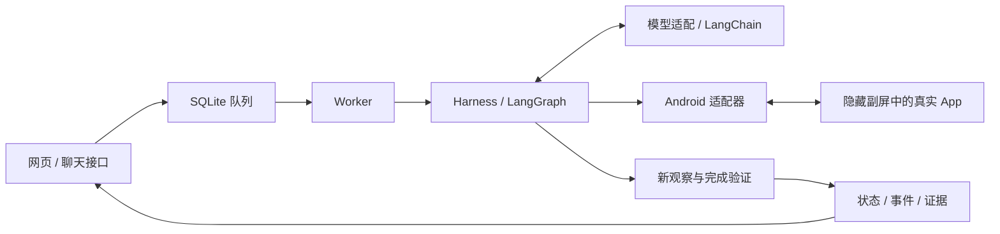

# Sidecar（伴行）技术方案

v0.5 · 2026-10-15 · 基于当前工作区实现

Sidecar 是通过真实 Android App 界面执行自然语言任务的单 Agent 原型。
Mac 运行任务服务与模型调用，Android 15 模拟器的隐藏副屏承载 App 操作。
网页和聊天接口用于提交、查询、暂停与恢复任务。本文只说明已有实现；代码片段均摘自当前源码。

## 1. 架构与执行流程



每一步执行“观察 → 模型决策 → 策略检查 → 执行一次 → 再观察”。
模型输出受约束的 `Action`，不能直接运行终端命令。`finish` 只是申请验证，
是否完成由 Harness 决定。登录、验证码和受保护的最终提交步骤进入人工交接。

| 职责 | 真实代码 |
| --- | --- |
| 任务、观察、动作和验证契约 | [contracts.py](../src/sidecar/contracts.py) |
| 任务主循环、预算、交接与恢复 | [harness.py](../src/sidecar/harness.py) |
| 模型结构化输出与上下文 | [model.py](../src/sidecar/model.py) |
| 队列与独立执行进程 | [jobs.py](../src/sidecar/jobs.py)、[worker.py](../src/sidecar/worker.py) |
| 网页/API 与聊天兼容接口 | [server.py](../src/sidecar/server.py)、[openai_compat.py](../src/sidecar/openai_compat.py) |

## 2. 副屏操作与视频证据

[displays.py](../src/sidecar/displays.py) 使用 scrcpy 创建隐藏虚拟显示，绑定显示 ID、
unique ID 与 boot ID，拒绝过期显示和不匹配的尺寸，不回退操作主屏。
当前副屏实现要求 Android 15+、ADB、scrcpy 和 FFmpeg；原型不依赖 Root 或修改 ROM。

[android.py](../src/sidecar/android.py) 将控件树和截图转成观察，校验动作目标与受保护区域。
文字输入通过 [textbridge](../android/textbridge/README.md) 对指定可编辑节点执行
`ACTION_SET_TEXT`，避免使用全局键盘或剪贴板输入。

[video.py](../src/sidecar/video.py) 管理每轮任务的录像与实时预览：CLI 保存 MKV，
匹配版本的 scrcpy-server 输出 H.264，由 FFmpeg 解码为预览帧。
普通观察可使用近期帧；动作前复核和最终验证独立采集。主机收到帧的时间不等于设备产生帧的时间。
暂停或恢复分别管理录像会话，媒体接口沿用配对鉴权。

## 3. 轻量 DDD 与恢复规则

将任务规则与框架、数据库和设备操作分开：

- [lifecycle.py](../src/sidecar/lifecycle.py)：纯函数决定取消、完成、暂停与恢复规则。
- [execution_control.py](../src/sidecar/execution_control.py)：协调控制请求。
- [store.py](../src/sidecar/store.py) 与队列：在事务和执行锁内应用规则、保存结果。

例如，取消请求不能被迟到的完成结果覆盖。以下是实际领域函数：

```python
def queue_finish(current: str, signal: str, proposed: str, reason: str) -> StatusChange | None:
    if current in TERMINAL:
        return None
    if signal == "cancel":
        return StatusChange("cancelled", "已取消；已执行的操作不会自动撤销")
    return StatusChange(proposed, reason)
```

执行前先写动作意图；操作结果不确定时记录 `uncertain` 并交接，不能盲目重放。
恢复保留原任务与完成标准，重新观察后再决策。队列索引、执行记录和图检查点各有职责，
通过恢复对账处理进程中断，不声称具有跨数据库原子事务。

## 4. 完成门禁：模型判断与程序证据分开

`Task.requirement` 随提交、队列和检查点保存。Clock 新任务在队列与 Harness 入口共用
`infer_requirement`，区分开启、关闭与未知意图；程序目标不从模型生成的 criteria 反推。

以下是 [Harness._verify](../src/sidecar/harness.py) 中的实际判定片段。
模型与程序检查同一次新观察；已要求程序验证时，异常或证据不足都不能降级放行：

```python
model_passed = verification.satisfies(task)
program = None
if task.requirement:
    from sidecar.verifiers import evaluate

    try:
        program = evaluate(task, observation)
    except Exception:
        program = {"status": "uncertain", "reason": "程序验证异常，未确认完成",
                   "observation_id": observation.id, "evidence": []}
can_complete = model_passed and (program is None or program["status"] == "passed")
evidence.update(
    model_verification=verification.model_dump(), program_verdict=program,
    conclusion="completed" if can_complete else "not_completed",
    method="model_and_program" if task.requirement else "model_only",
)
```

[verifiers.py](../src/sidecar/verifiers.py) 的 Clock 验证器限定 Google Clock 7.5：

- 从父子节点关联已保存卡片、精确 `onoff` 资源 ID、时间与开关三态。
- 目标含糊、意图冲突、节点截断、隐藏节点、额外窗口或未知页面结构返回 `uncertain`。
- 页面结构使用[真实样本生成的白名单](../src/sidecar/assets/clock-page-paths.json)。
- 明确状态不符时反馈给模型重新决策，累计三次程序拒绝后交接；不确定时直接交接。

报告分别保存模型自评、程序 verdict、最终 conclusion 和观察编号。
程序拒绝时不展示一排模型通过标记。未配置专用验证的任务标记 `model_only`，不等同于程序核验。

## 5. 已有验证证据

| 证据 | 覆盖内容 |
| --- | --- |
| [Clock 真实样本](../tests/fixtures/google_clock/README.md) | 关闭列表、开启列表、展开卡片、时间选择器、标签弹窗和恢复状态，共六份 XML/PNG/元数据 |
| [完成门禁测试](../tests/test_completion_gate.py) | 模型误报、意图与时间冲突、遮挡、异常、直接启动和恢复 |
| [采集测试](../tests/test_capture.py) | 页面变化拒绝保存、显示绑定失效、禁止覆盖与文件摘要 |
| [视频验证记录](video-upgrade.md) | Android 15 模拟器连续帧、录像和主屏前台一致性检查 |

最近一次完整回归：**468 passed、4 skipped**；Ruff、JavaScript 语法与差异空白检查通过。
这是代码回归数量，不是 Agent 真实任务成功率。

当前验收边界：已验证的是模拟器局部副屏操作和 Clock 固定版本证据，尚不能声称实体手机
用户持续打字时完全不受影响。Clock 仅证明可见记录的时间与开关状态，不证明全局唯一性、
日期铃声或其他记录未变；上游未报告的遮挡也无法由结构白名单发现。Gmail 草稿验证尚未完成，
不列入已验收功能。真实账号画面保存在本地，不进入公开测试样本。

## 6. 实际采用的开源能力与研究启发

| 来源 | 本项目采用的内容 |
| --- | --- |
| [scrcpy](https://github.com/Genymobile/scrcpy) | 实际依赖：虚拟显示、服务端视频流、CLI 录像；本项目管理会话、输入策略和证据新鲜度 |
| [uiautomator2](https://github.com/openatx/uiautomator2) | 实际依赖：读取控件树与设备自动化；外层增加目标限制、超时和不确定结果处理 |
| [Phone GUI Agents 综述仓库](https://github.com/PhoneLLM/Awesome-LLM-Powered-Phone-GUI-Agents) | 研究参考：从框架、界面定位和评测三个方向审视方案；落实为单 Agent 主循环、独立验证和真实样本回归，未引入其中其他 Agent 实现 |

scrcpy 的[虚拟屏文档](https://github.com/Genymobile/scrcpy/blob/master/doc/virtual-display.md)
说明输入法显示策略；[开发文档](https://github.com/Genymobile/scrcpy/blob/master/doc/develop.md)
说明分离通道及精确版本匹配；[录像文档](https://github.com/Genymobile/scrcpy/blob/master/doc/recording.md)
说明设备时间戳。当前实测版本为 5.0.1。

本项目的工程工作集中在把这些能力接成可恢复、可交接、可追溯的任务闭环，
并限制模型自评对最终完成状态的影响。虚拟显示和视频传输能力归属于上游，
本地回归与完成门禁也不代表已取得公开基准成绩。
